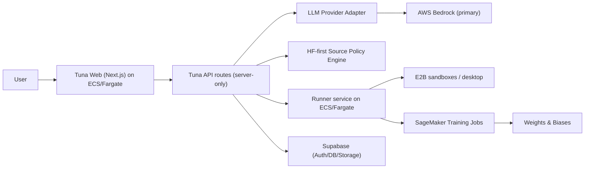

# AWS Runtime Target (Tuna)

This document locks the default cloud topology for Tuna during the hackathon build:

- **Web app + API routes:** ECS/Fargate service
- **Runner service:** ECS/Fargate service
- **LLM provider target:** AWS Bedrock (via server-side provider adapter)
- **Fine-tuning execution target:** SageMaker Training Jobs
- **Experiment tracking:** Weights & Biases (server-side API key only)

## Architecture Baseline

## Runtime Decisions (Locked)

1. **Application deployment**
   - Deploy Next.js app server in ECS/Fargate behind ALB.
   - Keep all secrets server-side (task definition + Secrets Manager/SSM).
2. **Runner deployment**
   - Deploy `e2b-runner-service` separately in ECS/Fargate.
   - Keep token-auth enabled (`RUNNER_AUTH_TOKEN`).
3. **LLM provider boundary**
   - Runtime uses a provider selector (`TUNA_LLM_PROVIDER`) and defaults to `aws_bedrock`.
   - Provider choice remains server-only.
4. **Training target**
   - `training_submit` contract now supports selecting `backend: "sagemaker"` and passing SageMaker/W&B metadata server-side.
   - Existing E2B training path remains available as fallback for hackathon velocity.

## Server-Only Environment Contract

- `TUNA_LLM_PROVIDER=aws_bedrock`
- `AWS_REGION=...`
- `AWS_ACCESS_KEY_ID=...` / `AWS_SECRET_ACCESS_KEY=...` (or task role)
- `AWS_BEDROCK_MODEL_ID=...`
- `SAGEMAKER_EXECUTION_ROLE_ARN=...`
- `SAGEMAKER_TRAINING_IMAGE_URI=...`
- `WANDB_API_KEY=...`
- `WANDB_PROJECT=...`

Never expose any of these in `NEXT_PUBLIC_*` variables.

## Deploy Asset Bundle (ECS/Fargate)

The repository now includes concrete deployment assets:

- `deploy/aws/ecs/app-task-definition.template.json`
- `deploy/aws/ecs/app-service.template.json`
- `e2b-runner-service/deploy/aws/runner-task-definition.template.json`
- `e2b-runner-service/deploy/aws/runner-service.template.json`
- `deploy/aws/env-secrets-mapping.md`
- `deploy/aws/iam-checklist.md`
- `deploy/aws/rollout-rollback-runbook.md`

## Phase 2 Validation Checklist

- [ ] **Chat runtime**: `TUNA_LLM_PROVIDER=aws_bedrock` serves streaming chat + tool calls.
- [ ] **Title generation**: title endpoints use provider abstraction (not Azure-only path).
- [ ] **Training backend**: `backend="sagemaker"` executes real SageMaker jobs.
- [ ] **W&B runtime**: run links are emitted for completed training runs.
- [ ] **Source policy**: HF-first enforcement + escalation evidence are emitted at runtime.
- [ ] **Deploy assets**: ECS/Fargate task definition templates + runbook are present.
- [ ] **Security**: no provider/training/tracking secrets are client-exposed.

## Naming No-Regression Guard

- Do not add new legacy alias environment variables.
- Do not add old-brand-named assets, paths, or docs.
- If a temporary compatibility alias is unavoidable, it must include:
  - explicit sunset note,
  - migration impact note,
  - removal target version/date.

