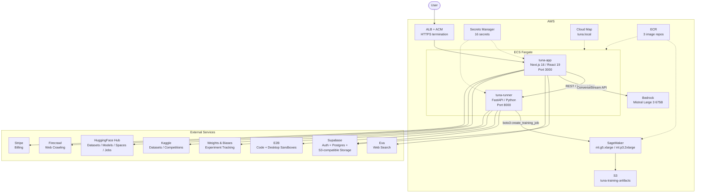
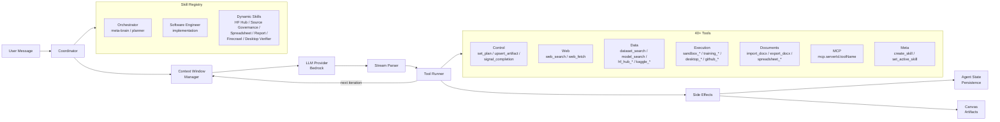
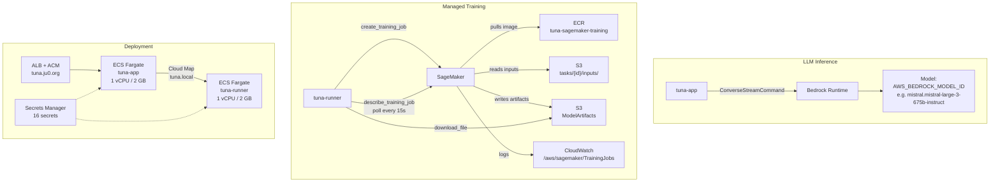
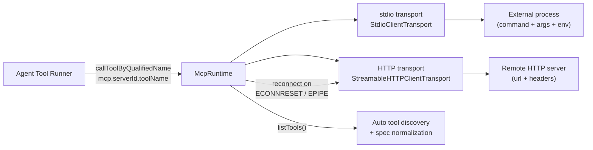

# Tuna

**Natural-language LLM fine-tuning and deployment orchestration.**

Tuna is a conversational AI platform where users describe ML tasks in plain English and an agentic system handles the rest -- planning, data sourcing, training script generation, managed compute execution (E2B sandboxes / AWS SageMaker), and artifact delivery. The entire workflow plays out through a chat interface paired with a live canvas that renders plans, research, training curves, sandboxes, and documents in real time.

---

## Features

- **Plan-and-execute agent** -- An orchestrator decomposes goals into multi-step plans, delegates to a software-engineer skill and 11+ dynamic specialist skills, and iterates with tool feedback until completion.
- **40+ built-in tools** -- Web search (Exa), web crawl (Firecrawl), HuggingFace Hub, Kaggle, GitHub, dataset/model discovery, sandbox execution, desktop automation, document/spreadsheet authoring.
- **Live canvas with rich artifacts** -- Artifact panels for execution plans, research results, data analysis, training curves, a full Python sandbox (editor + terminal + file browser + browser preview), a virtual desktop, rich-text documents, and spreadsheets. See [Canvas Artifacts](#canvas-artifacts).
- **Deep AWS integration** -- Bedrock for LLM inference, SageMaker for managed training, ECS Fargate for deployment, S3 for artifact storage, Secrets Manager, Cloud Map. See [AWS Integration](#aws-integration).
- **Weights & Biases experiment tracking** -- Every training run is tracked as a W&B run with status transitions, backend metadata, and a direct link surfaced in the UI. See [Weights & Biases](#weights--biases).
- **HuggingFace Hub as a first-class citizen** -- Dataset exploration, model search, Gradio Space execution, HF Jobs lifecycle, documentation fetching -- all as native agent tools. See [HuggingFace Hub](#huggingface-hub).
- **MCP (Model Context Protocol) server support** -- Connect external tools via stdio or HTTP transports. Per-user server management, automatic tool discovery, transport-error reconnection. See [MCP Servers](#mcp-servers).
- **LLM backend** -- AWS Bedrock (Mistral Large 3 675B). Configurable via `TUNA_LLM_PROVIDER`.
- **Tiered source governance** -- HF Hub first, then GitHub/Kaggle, then open web, then desktop escalation. Configurable strictness (`off` / `prefer` / `strict`) with audit telemetry at each tier.
- **Human-in-the-loop supervision** -- Four levels (`full_auto` / `minimal` / `standard` / `strict`) with 9 checkpoint types, auto-approval rules, and override audit logging.
- **Credit-based billing** -- Stripe subscriptions/top-ups, per-token LLM metering with cached-token discounts, per-minute sandbox billing.

---

## System Architecture



---

## Agent Architecture



**Coordinator loop**: Each user message enters the coordinator, which loads persisted `AgentState`, builds a system prompt from the active skill, calls the LLM with tool definitions, parses the streamed response, executes tool calls through the tool runner, applies side effects (plan updates, artifact upserts, skill switches), and iterates until the agent signals completion or a budget is exhausted (max iterations, tool calls, or wall-clock time).

**State**: Phase tracking (`idle` / `planning` / `executing` / `verifying` / `reflecting` / `blocked` / `done` / `failed`), conversation memory with rolling summaries, artifact store, budget counters, and source-policy constraints.

**Context window**: 262K token budget (Mistral Large 3). Per-message trimming (tool results capped at 24K chars, assistant at 32K), automatic summarization when usage exceeds ~70%, aggressive trim on context-length errors.

---

## AWS Integration

Tuna uses five AWS services in the critical path:



**Bedrock** (`src/lib/aws-bedrock/service.ts`) -- Uses `@aws-sdk/client-bedrock-runtime` with `ConverseStreamCommand` for streaming tool-calling inference. Credential chain: static env keys, then `~/.aws/login/cache` SSO credentials, then SDK defaults. Automatic retry on expired tokens. Tool names are sanitized to Bedrock's `[a-zA-Z0-9_-]` constraint with bidirectional mapping.

**SageMaker** (`e2b-runner-service/sagemaker_executor.py`) -- Submits training jobs via `create_training_job`. Input data, scripts, and extra files are uploaded to S3 as named channels (`training`, `script`, `extra-N-name`). The custom training image (CUDA 12.4 + PyTorch, built from `deploy/aws/sagemaker-training-image/Dockerfile`) prefetches HF models/datasets, executes the training script, and collects output artifacts. Jobs are polled via `describe_training_job` at 15-second intervals. On completion, model artifacts are downloaded from the `S3ModelArtifacts` URI. On failure, CloudWatch logs are fetched (up to 5 streams, 200 events each). Default instance: `ml.g5.xlarge`, volume: 100 GB, max runtime: 2 hours.

**ECS Fargate** -- Two services (`tuna-app` on port 3000, `tuna-runner` on port 8000) in private subnets behind an ALB with ACM HTTPS. Internal communication via Cloud Map service discovery (`tuna.local`). Infrastructure defined in `infra/lib/infra-stack.ts` (AWS CDK).

**S3** -- `tuna-training-artifacts` bucket stores training inputs, model outputs, and metadata. Supabase's S3-compatible storage handles user uploads and canvas artifacts separately.

**Secrets Manager** -- 16 secrets covering Supabase, Postgres, Stripe, Resend, E2B, Exa, W&B, and Kaggle credentials.

---

## Weights & Biases

The runner service (`e2b-runner-service/wandb_runtime.py`) tracks every training run as a W&B experiment:

```mermaid
flowchart LR
    Submit["training_submit"] --> Init["wandb.init()<br/>project: tuna<br/>job_type: runner_training"]
    Init --> LogStart["log runner/status = running<br/>log task_id, backend"]
    LogStart --> Train["SageMaker or E2B<br/>training execution"]
    Train --> LogEnd["log runner/status = completed|failed<br/>write summary metrics"]
    LogEnd --> Finish["run.finish()<br/>capture run_url + run_id"]
    Finish --> Meta["Write to metadata.json<br/>Upload to Supabase Storage"]
    Meta --> UI["TrainingArtifact renders<br/>W&B run link in canvas"]
```



- `WandbRunState` tracks: `run_id`, `run_url`, `project`, `entity`, `run_name`, `status`, `mode` (`online` / `offline` / `disabled`).
- Status transitions (`running`, `completed`, `failed`) are logged as `runner/status` and `runner/timestamp` metrics.
- `run_url` is captured from `wandb.Run.url` at init and again at finish, then written to `metadata.json` alongside all other task metadata and uploaded to Supabase Storage.
- The `TrainingArtifact` component on the frontend reads this metadata and surfaces the W&B run link directly in the canvas.
- Sensitive keys in W&B payloads are automatically redacted (tokens, secrets, API keys, authorization headers).
- Mode auto-downgrades from `online` to `offline` if `WANDB_API_KEY` is missing.

---

## HuggingFace Hub

HuggingFace Hub is a first-class integration with 9 dedicated agent tools (`src/lib/agent/tools/huggingface.ts`) plus a specialist dynamic skill:

| Tool | What it does | HF API endpoint |
|------|-------------|----------------|
| `hf_hub_search` | Search models, datasets, or Spaces by query/author/tags | `GET /api/models`, `/api/datasets`, `/api/spaces` |
| `hf_dataset_explore` | Inspect dataset info, splits, and preview rows | `GET datasets-server.huggingface.co/info`, `/splits`, `/first-rows` |
| `hf_dataset_query` | Full-text search or row listing within a dataset | `GET datasets-server.huggingface.co/search`, `/rows` |
| `hf_get_documentation` | Fetch README and metadata for any repo | `GET /api/{type}/{id}` + raw file fetch |
| `hf_space_run` | Execute a Gradio Space API endpoint | Gradio SSE protocol (`/call/{apiName}`) |
| `hf_job_run` | Submit a HF Job (custom image, command, env, secrets, flavor) | `POST /api/jobs` |
| `hf_job_status` | Poll job status | `GET /api/jobs/{jobId}` |
| `hf_job_logs` | Fetch job logs | `GET /api/jobs/{jobId}/logs` |
| `hf_job_cancel` | Cancel a running job | `POST /api/jobs/{jobId}/cancel` |

The **HuggingFace Hub Specialist** skill (`skills/dynamic/huggingface_hub.json`) activates automatically when the orchestrator detects Hub-related tasks. It has access to all HF tools and routes results to the canvas as dataset, model card, or markdown artifacts.

HF is also embedded in the training pipeline: the SageMaker training image's entrypoint (`train-entrypoint.py`) prefetches HF models and datasets at job start using the `HUGGINGFACE_HUB_TOKEN` injected via SageMaker environment variables.

Token resolution: per-user integration token from the database, falling back to `HUGGINGFACE_TOKEN` / `HF_TOKEN` env vars.

---

## MCP Servers

Tuna supports the [Model Context Protocol](https://modelcontextprotocol.io/) for connecting external tools:



- **Configuration**: Servers are defined via the `TUNA_MCP_SERVERS` env var (JSON). Supports array format, `{ servers: [...] }`, and Cursor/Claude-style `{ mcpServers: { id: {...} } }` keyed format.
- **Per-user servers**: Users can add their own MCP servers through the settings UI. Stored in Supabase (`user_mcp_servers` table) with per-user tool approval tracking.
- **Two transports**: `stdio` (local process with `command`, `args`, `env`) and `http` (remote server with `url`, `headers`). HTTP transport includes a configurable timeout (default 20s) and automatic reconnection on transport errors.
- **Tool naming**: Tools are qualified as `mcp.<serverId>.<toolName>` and exposed to the agent alongside built-in tools. The agent can call any discovered MCP tool in the same way it calls native tools.
- **Built-in Firecrawl MCP**: Special handling for the `firecrawl-mcp` server -- token resolution from env or user integration tokens, URL normalization in results.
- **Security**: Server URLs are validated (HTTPS-only, no private/localhost IPs). Sensitive keys in arguments and results are redacted before persistence.

---

## Canvas Artifacts

The canvas is the right panel of the UI. It renders structured, interactive artifacts produced by the agent during execution. Each artifact type has a dedicated renderer:

| Artifact | Renderer | What it shows |
|----------|----------|--------------|
| **Plan** | `PlanArtifact` | Execution plan as a checklist. Each step has status (todo/doing/done/failed/skipped), title, description, and evidence. |
| **Training** | `TrainingArtifact` | Live training progress: status badge with elapsed timer, terminal output via `TerminalViewer` (xterm.js), training curve chart (loss/metrics over steps via Recharts), W&B run link. Polls the runner for live updates. |
| **Sandbox** | `PythonSandboxArtifact` | Full interactive Python environment: code editor, terminal output, file browser, browser preview. Tracks sandbox state (`idle` / `starting` / `running` / `completed` / `failed`). Streams events from the E2B runner. |
| **Desktop** | `DesktopArtifact` | Virtual desktop viewer: live screenshots, streaming video, recording playback with frame-by-frame navigation, interactive mouse overlay, user takeover controls. |
| **Document** | `DocumentArtifact` | Rich-text editor (TipTap) with bold, italic, headings, lists, blockquotes, code blocks, tables. Import from DOCX, export to DOCX. HTML sanitized via DOMPurify. |
| **Spreadsheet** | `SpreadsheetArtifact` | Full spreadsheet editor (Fortune Sheet + XLSX.js). Multiple sheets, cell editing, formula support. Import/export `.xlsx` files. |
| **Research** | `ResearchArtifact` | Web search results with query, provider, scores, snippets, published dates. Also renders data curation results. |
| **Data Analysis** | `DataAnalysisArtifact` | EDA results rendered as markdown, tables, or charts. |
| **Intent** | `IntentArtifact` | Agent's parsed understanding of user intent: task type, I/O, budget, timeline, quality, data requirements, confidence. |
| **Clarification** | `ClarificationArtifact` | Structured questions (multiple choice, text, number, date, boolean) for the agent to gather missing information. |
| **Provider Comparison** | `ProviderComparisonArtifact` | GPU provider comparison (Lambda Labs, RunPod, Together AI) with pricing and estimated training time. |
| **Export** | `ExportArtifact` | Deployment options: push to HuggingFace, download weights, export code, push to GitHub. |

Artifacts are streamed to the client as `artifact_upsert` SSE events during agent execution. The canvas includes a **timeline bar** at the bottom for scrubbing through artifact states over time, similar to a video timeline but for the agent's work progression.

---

## Tech Stack

| Layer | Technologies |
|-------|-------------|
| **Frontend** | Next.js 16 (App Router), React 19, Tailwind CSS 4, Zustand, Framer Motion, TipTap (rich text), xterm.js (terminal), Recharts (charts), Fortune Sheet (spreadsheets), Lucide icons |
| **Backend** | Next.js API Routes (63 endpoints), Supabase (Auth + Postgres + S3-compatible Storage), Stripe, Resend, Zod |
| **AI / ML** | AWS Bedrock (Mistral Large 3 675B), SageMaker (CUDA 12.4 + PyTorch), W&B, HuggingFace Hub, Kaggle API |
| **Runner** | Python FastAPI, E2B SDK (code + desktop sandboxes), boto3, httpx, wandb |
| **Infra** | AWS CDK (TypeScript), ECS Fargate, ALB + ACM, ECR (3 repos), S3, Secrets Manager, Cloud Map, VPC with NAT |
| **MCP** | `@modelcontextprotocol/sdk`, stdio + HTTP transports, per-user server config |

---

## Getting Started

### Prerequisites

- Node.js 20+
- A Supabase project (Auth + Postgres + Storage)
- At least one LLM provider configured (AWS Bedrock recommended)

### Environment

Copy `.env.example` to `.env.local` and set required values. Minimum:

```env
NEXT_PUBLIC_SUPABASE_URL=...
NEXT_PUBLIC_SUPABASE_ANON_KEY=...
NEXT_PUBLIC_APP_URL=http://localhost:3000

# AWS Bedrock
AWS_REGION=us-east-1
AWS_BEDROCK_MODEL_ID=mistral.mistral-large-3-675b-instruct
AWS_ACCESS_KEY_ID=...
AWS_SECRET_ACCESS_KEY=...

TUNA_LLM_PROVIDER=aws_bedrock
```

### Database

Apply `supabase/schema.sql` in the Supabase SQL editor, or:

```bash
npm run migrate
npm run check-migration
```

### Storage Buckets

Create in Supabase dashboard: `uploads`, `artifacts`. Optional for runner: `runner-artifacts`.

### Run

```bash
npm install
npm run dev
```

Open `http://localhost:3000`. New users are redirected to `/onboarding`.

### Runner Service (optional)

The Python runner service enables sandbox execution, SageMaker training, and desktop automation. Set `E2B_RUNNER_URL` and `E2B_RUNNER_TOKEN` in `.env.local`. See `e2b-runner-service/README.md`.

---

## Deployment

Production runs on **AWS ECS Fargate** as two services behind an ALB with HTTPS:

| Service | Image | Resources | Role |
|---------|-------|-----------|------|
| `tuna-app` | Next.js | 1 vCPU / 2 GB | Web UI, API, agent coordinator, Bedrock inference |
| `tuna-runner` | FastAPI | 1 vCPU / 2 GB | E2B sandboxes, SageMaker orchestration, W&B tracking |

Infrastructure is defined in `infra/lib/infra-stack.ts` (AWS CDK). SageMaker training uses a custom CUDA 12.4 + PyTorch image built from `deploy/aws/sagemaker-training-image/Dockerfile`.

See `deploy/aws/` for ECS task/service templates, IAM policies, env/secrets mapping, and the rollout/rollback runbook.

---

## Project Structure

```
src/
  app/                  # Next.js App Router: pages, API routes, components
    [[...chatId]]/      # Main chat + canvas page
    api/                # 63 REST endpoints (chat, runner, storage, billing, MCP, integrations)
    components/
      artifacts/        # Canvas artifact renderers (training, sandbox, desktop, document, ...)
      ui/               # Shared UI (agent status, terminal, timeline, modals, ...)
  lib/
    agent/              # Agent coordinator, registry, tools, skills, context management
      skills/           # Orchestrator, software engineer, 11 dynamic JSON skills
      tools/            # 40+ tool implementations
    llm/                # Provider abstraction (Bedrock)
    aws-bedrock/        # Bedrock ConverseStream service
    supabase/           # Auth middleware, admin/server/browser clients, S3 storage
    mcp/                # MCP server manager, runtime, validation, user config
    billing/            # Stripe integration, credit system, sandbox metering
    training/           # Metrics parsing, post-training finalization + PDF reports
    pipeline/           # Agentic pipeline orchestrator (intent -> training -> export)
    supervision/        # Human-in-the-loop checkpoint system
e2b-runner-service/     # Python FastAPI runner (E2B, SageMaker, W&B, Kaggle)
deploy/aws/             # ECS templates, IAM policies, SageMaker image, runbooks
infra/                  # AWS CDK stack (VPC, ECS, ALB, ECR, S3, Secrets Manager)
```

---

## Security

- Only `NEXT_PUBLIC_*` variables are exposed to the browser. All API keys, tokens, and service credentials stay server-side.
- Runner communication uses bearer-token auth over internal networking (Cloud Map service discovery in production).
- File access tools block `.env`, `.git`, `node_modules`, and `.tuna` paths.
- Dangerous shell commands (e.g. `rm -rf`) are blocked by the command guard.
- MCP server URLs are validated (HTTPS-only, no private/localhost IPs). Tool approvals are per-user.
- W&B payloads are sanitized to redact tokens, secrets, API keys, and authorization headers before persistence.
