# Tuna Console

Agentic chat + Canvas console built with Next.js App Router. It orchestrates a server-side LLM-backed agent runtime, streams runs to the browser over **SSE**, and persists chats/messages/state in **Supabase** (Auth + Postgres + Storage). Optional **E2B runner** support enables sandbox sessions, training jobs, and desktop sessions—without exposing runner URLs/tokens to the client.

> **Security note:** Anything prefixed with `NEXT_PUBLIC_*` is bundled into the browser. Keep API keys/tokens server-side only.

This is a [Next.js](https://nextjs.org) project bootstrapped with [`create-next-app`](https://nextjs.org/docs/app/api-reference/cli/create-next-app).

## Mission & End-to-End Flow
Tuna enables "vibe-tuning" via natural-language prompts: a guided, end-to-end workflow that helps users go from raw data to a deployed model.

Typical pipeline stages:
- Data sourcing (files, integrations, and web/Hub discovery)
- Preprocessing and curation
- EDA and data quality checks
- Training script generation
- Compute selection and provider comparison (when needed)
- Model training and evaluation
- Model analysis and iteration
- Deployment/hosting or export (API, Hub, or local)

## Table of contents
- [Mission & End-to-End Flow](#mission--end-to-end-flow)
- [Getting Started](#getting-started)
  - [Prereqs (local dev)](#prereqs-local-dev)
  - [1) Configure environment](#1-configure-environment)
  - [2) Apply Supabase schema](#2-apply-supabase-schema)
  - [3) Install and run](#3-install-and-run)
- [Learn More](#learn-more)
- [Deploy on Vercel](#deploy-on-vercel)
  - [Vercel environment variables](#vercel-environment-variables)
- [Docker (local dev)](#docker-local-dev)
  - [Prereqs (Docker)](#prereqs-docker)
  - [Run the app in Docker (dev)](#run-the-app-in-docker-dev)
  - [Sandbox notes](#sandbox-notes)
- [Architecture](#architecture)
  - [Key entry points (source-of-truth)](#key-entry-points-source-of-truth)
  - [Overall system](#overall-system)
  - [AWS runtime target (locked for hackathon)](#aws-runtime-target-locked-for-hackathon)
  - [E2B Runner Service](#e2b-runner-service)
    - [Runner flow](#runner-flow)
    - [Production runner (Azure)](#production-runner-azure)
    - [Deployment flow (Azure Container Apps)](#deployment-flow-azure-container-apps)
    - [Deployment guide (Azure Container Apps, reference for coding agents)](#deployment-guide-azure-container-apps-reference-for-coding-agents)
      - [1) Prereqs](#1-prereqs)
      - [2) Build + push the runner image](#2-build--push-the-runner-image)
      - [3) Create/update the Container App](#3-createupdate-the-container-app)
      - [4) Set secrets + env vars (server-only)](#4-set-secrets--env-vars-server-only)
      - [5) Custom domain + TLS (optional but recommended)](#5-custom-domain--tls-optional-but-recommended)
      - [6) App configuration (Vercel server-only env)](#6-app-configuration-vercel-server-only-env)
      - [7) Verify](#7-verify)
      - [Troubleshooting](#troubleshooting)
  - [MCP Connectors (optional)](#mcp-connectors-optional)
    - [How it works](#how-it-works)
    - [MCP flow](#mcp-flow)
    - [Configure servers via env (`TUNA_MCP_SERVERS`)](#configure-servers-via-env-tuna_mcp_servers)
    - [Add per-user servers (HTTPS only)](#add-per-user-servers-https-only)
  - [Integrations (optional)](#integrations-optional)
    - [Tokens](#tokens)
    - [GitHub repo connections](#github-repo-connections)
  - [Email notifications (optional)](#email-notifications-optional)
    - [Email flow](#email-flow)
  - [Exa Web Search (optional)](#exa-web-search-optional)
    - [Setup](#setup)
    - [Browser fallback when `web_fetch` is insufficient (optional)](#browser-fallback-when-web_fetch-is-insufficient-optional)
  - [Dataset/model source policy (server-side)](#datasetmodel-source-policy-server-side)
  - [API routes (overview)](#api-routes-overview)
    - [Chat + artifacts (`src/app/api/chat/**`)](#chat--artifacts-srcappapichat)
    - [Storage (`src/app/api/storage/**`)](#storage-srcappapistorage)
    - [Runner proxies (`src/app/api/runner/**`)](#runner-proxies-srcappapirunner)
    - [Sharing (`src/app/api/share/**`)](#sharing-srcappapishare)
    - [Integrations (`src/app/api/integrations/**`)](#integrations-srcappapiintegrations)
    - [MCP (`src/app/api/mcp/**`)](#mcp-srcappapimcp)
    - [Billing (`src/app/api/billing/**`)](#billing-srcappapibilling)
    - [Account, runs, and auth](#account-runs-and-auth)
  - [Subsystems](#subsystems)
    - [Auth + onboarding gate](#auth--onboarding-gate)
    - [Onboarding personalization](#onboarding-personalization)
    - [Chat streaming (SSE) + persistence](#chat-streaming-sse--persistence)
    - [Interaction semantics](#interaction-semantics)
    - [File retention](#file-retention)
    - [Agent loop (skills + tools + memory)](#agent-loop-skills--tools--memory)
    - [Artifacts + Canvas timeline (replay/scrub)](#artifacts--canvas-timeline-replayscrub)
    - [Runner integration (sandbox / training / desktop)](#runner-integration-sandbox--training--desktop)
    - [Export + Storage (uploads vs exports)](#export--storage-uploads-vs-exports)
    - [Storage access via `/api/storage/**` (Files Drawer)](#storage-access-via-apistorage-files-drawer)
    - [Sharing (public snapshot + replay)](#sharing-public-snapshot--replay)
    - [Optional: first-turn intent pipeline](#optional-first-turn-intent-pipeline)
  - [Data model (high level)](#data-model-high-level)
    - [Database tables (overview)](#database-tables-overview)
    - [Database architecture (full)](#database-architecture-full)
  - [Configuration & secrets (names only)](#configuration--secrets-names-only)
  - [Billing & credits](#billing--credits)

**Reader guide (where to start):**
- **Run locally**: [Getting Started](#getting-started)
- **Deploy**: [Deploy on Vercel](#deploy-on-vercel) (runner is under [E2B Runner Service](#e2b-runner-service))
- **Enable optional capabilities**: [MCP Connectors](#mcp-connectors-optional), [Integrations](#integrations-optional), [Exa Web Search](#exa-web-search-optional), [Email notifications](#email-notifications-optional)
- **Code reference**: [API routes](#api-routes-overview) + [Architecture](#architecture)

## Getting Started

### Prereqs (local dev)
- Node.js >= 20
- Supabase project (Auth + Postgres + Storage)
- LLM provider credentials (AWS Bedrock by default; Azure OpenAI/OpenAI are supported via `TUNA_LLM_PROVIDER`)

### 1) Configure environment
Copy `.env.example` to `.env.local` and fill in values.

Minimum required to boot the app:

```env
NEXT_PUBLIC_SUPABASE_URL=...
NEXT_PUBLIC_SUPABASE_ANON_KEY=...
NEXT_PUBLIC_APP_URL=http://localhost:3000

AZURE_OPENAI_ENDPOINT=...
AZURE_OPENAI_API_KEY=...
AZURE_OPENAI_DEPLOYMENT_NAME=...
AZURE_OPENAI_API_VERSION=...

# Optional provider selector (server-side)
TUNA_LLM_PROVIDER=aws_bedrock
```

### 2) Apply Supabase schema
The source-of-truth schema lives in `supabase/schema.sql`.

- Option A: run `supabase/schema.sql` in the Supabase SQL editor
- Option B: run the local script (requires `POSTGRES_URL`/`DATABASE_URL` or `SUPABASE_DB_*` vars; see `.env.example`):

```bash
npm run migrate
```

Validate:

```bash
npm run check-migration
```

Ensure Storage buckets exist: `uploads` and `artifacts` (and `runner-artifacts` if you deploy the runner service).

### 3) Install and run
First, install dependencies and run the development server:

```bash
npm install
npm run dev
# or
yarn dev
# or
pnpm dev
# or
bun dev
```

Open [http://localhost:3000](http://localhost:3000) with your browser to see the result.

You can start editing the chat UI by modifying `src/app/[[...chatId]]/page.tsx`. The page auto-updates as you edit the file.

This project uses [`next/font`](https://nextjs.org/docs/app/building-your-application/optimizing/fonts) to automatically optimize and load [Geist](https://vercel.com/font), a new font family for Vercel.

## Learn More

To learn more about Next.js, take a look at the following resources:

- [Next.js Documentation](https://nextjs.org/docs) - learn about Next.js features and API.
- [Learn Next.js](https://nextjs.org/learn) - an interactive Next.js tutorial.

You can check out [the Next.js GitHub repository](https://github.com/vercel/next.js) - your feedback and contributions are welcome!

## Deploy on Vercel

The easiest way to deploy your Next.js app is to use the [Vercel Platform](https://vercel.com/new?utm_medium=default-template&filter=next.js&utm_source=create-next-app&utm_campaign=create-next-app-readme) from the creators of Next.js.

Check out our [Next.js deployment documentation](https://nextjs.org/docs/app/building-your-application/deploying) for more details.

### Vercel environment variables

Set these in your Vercel Project Settings (do not expose server secrets to the client). For the full list, see `.env.example`.

```env
# Client-exposed
NEXT_PUBLIC_SUPABASE_URL=...
NEXT_PUBLIC_SUPABASE_ANON_KEY=...
NEXT_PUBLIC_APP_URL=https://your-app.vercel.app

# Server-only
AZURE_OPENAI_ENDPOINT=...
AZURE_OPENAI_API_KEY=...
AZURE_OPENAI_DEPLOYMENT_NAME=...
AZURE_OPENAI_API_VERSION=...
TUNA_LLM_PROVIDER=aws_bedrock

# Optional server-only
SUPABASE_SERVICE_ROLE_KEY=... # required for billing/webhooks + integrations/MCP admin flows
EXA_API_KEY=... # optional
E2B_RUNNER_URL=...            # required for sandbox/training/desktop
E2B_RUNNER_TOKEN=...
AWS_REGION=...                # when provider=aws_bedrock
AWS_BEDROCK_MODEL_ID=...
SAGEMAKER_EXECUTION_ROLE_ARN=... # for training backend=sagemaker
SAGEMAKER_TRAINING_IMAGE_URI=...
WANDB_API_KEY=...
WANDB_PROJECT=...

# Optional connectors (MCP)
TUNA_MCP_SERVERS=... # JSON string (see MCP Connectors section)

# Optional integration token fallbacks (server-wide)
HUGGINGFACE_TOKEN=...
HF_TOKEN=...
GITHUB_TOKEN=...
KAGGLE_TOKEN=...

# Optional email (Resend)
RESEND_API_KEY=...
RESEND_FROM_EMAIL=...
RESEND_FROM_NAME=...
TUNA_QUEUED_TASK_START_EMAIL_COOLDOWN_MINUTES=60

# Optional billing (Stripe)
STRIPE_SECRET_KEY=...
STRIPE_WEBHOOK_SECRET=...
NEXT_PUBLIC_STRIPE_SUBSCRIPTION_PRICE_ID=...
NEXT_PUBLIC_STRIPE_TOPUP_PRICE_ID=...
```

Notes for Vercel:
- Vercel serverless runtimes do not provide Python; the legacy `executePython` server action is disabled.
- Sandbox / training / desktop features work when you configure the external runner service (`E2B_RUNNER_URL`).
- Agent state persists in Supabase (`agent_states`). Runtime-created dynamic skills and local research notes may be written under `/tmp/tuna/*` on Vercel (ephemeral).

## Docker (local dev)

### Prereqs (Docker)
- Install Docker Desktop for macOS and make sure the Docker daemon is running.

### Run the app in Docker (dev)

```bash
docker compose up --build
```

Then open `http://localhost:3000`.

### Sandbox notes
- Interactive sandboxes / training / desktop sessions run via the external runner service and the `/api/runner/**` proxies (see `E2B Runner Service` below).
- This repo also includes a small dev-only server action, `executePython` in `src/app/actions.ts`, which spawns local `python3` with a 10s timeout. It is disabled on Vercel and is **not** a security boundary.

The env vars below are reserved for a future isolated local sandbox mode and are **not currently wired up** in runtime code:

- **`PYTHON_SANDBOX_MODE`**: planned values `auto | docker | local`
- **`PYTHON_SANDBOX_IMAGE`**: planned Docker image (e.g. `python:3.12-slim`)
- **`PYTHON_SANDBOX_TIMEOUT_MS`**: planned max runtime in milliseconds (e.g. `10000`)

## Architecture

This repo is a Next.js App Router “agentic chat + canvas” console:

- **Chat UI**: a client-side `ChatShell` that streams an agent run over **SSE** and renders both the chat transcript and a Canvas of artifacts.
- **Agent runtime**: server-only orchestration (`AgentCoordinator`) that calls Azure OpenAI, executes tools, records side effects (artifacts/timeline), and persists state.
- **Runner integration**: optional E2B runner service for sandboxes/training/desktop, proxied under `/api/runner/**` to keep runner URLs/tokens server-only.
- **Persistence**: Supabase Auth + Postgres tables for chats/messages/runs/state, plus Supabase Storage buckets for uploads and exported artifacts.

### Key entry points (source-of-truth)

- **Chat UI + SSE client**: `src/app/[[...chatId]]/page.tsx`
- **SSE endpoint**: `src/app/api/chat/stream/route.ts`
- **Agent loop**: `src/lib/agent/coordinator.ts`
- **Tools + security gates + side effects**: `src/lib/agent/tool-runner.ts`
- **MCP connectors (runtime + config)**: `src/lib/mcp/runtime.ts`, `src/lib/mcp/config.ts`
- **MCP API routes**: `src/app/api/mcp/**`
- **Integrations API routes**: `src/app/api/integrations/**`
- **E2B runner tools (sandbox/training/desktop)**: `src/lib/agent/tools/e2b-runner.ts`
- **Runner proxy API routes**: `src/app/api/runner/**`
- **Runner service**: `e2b-runner-service/`
- **Agent state persistence**: `src/lib/agent/persistence.ts`
- **Auth/onboarding middleware**: `src/lib/supabase/middleware.ts` (wired by `src/middleware.ts`)
- **Chat title generation**: `src/app/api/chat/title/route.ts`
- **Schema (tables + RLS)**: `supabase/schema.sql`
- **Exports + server Storage client**: `src/app/api/chat/artifacts/export/route.ts` + `src/lib/supabase/storage.ts`
- **Sharing snapshot + replay**: `src/app/api/chat/share/route.ts`, `src/app/api/share/[shareId]/route.ts`, `src/app/share/[shareId]/SharedChatReplay.tsx`
- **Sandbox / training / desktop artifacts (UI)**: `src/app/components/artifacts/PythonSandboxArtifact.tsx`, `src/app/components/artifacts/TrainingArtifact.tsx`, `src/app/components/artifacts/DesktopArtifact.tsx`

Dynamic skills are JSON files in `src/lib/agent/skills/dynamic/*.json` (and may also be created at runtime under `/tmp/tuna/skills/dynamic` on Vercel).

### Overall system

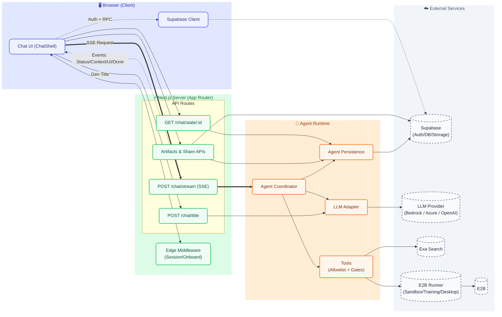

### AWS runtime target (locked for hackathon)

For the Tuna hackathon track, the cloud target is locked to:

- **App + API routes:** ECS/Fargate
- **Runner service:** ECS/Fargate
- **LLM provider target:** AWS Bedrock (selected via server-only `TUNA_LLM_PROVIDER`)
- **Fine-tuning execution:** SageMaker Training Jobs
- **Experiment tracking:** Weights & Biases

See `AWS_RUNTIME_TARGET.md` for the source-of-truth topology and env contract.
Deploy templates/runbooks live under `deploy/aws/` and `e2b-runner-service/deploy/aws/`.

Phase 2 validation checklist:
- [ ] Bedrock-backed chat stream works with `TUNA_LLM_PROVIDER=aws_bedrock`
- [ ] Title generation uses provider abstraction, not Azure-only path
- [ ] `backend="sagemaker"` runs real SageMaker execution
- [ ] Training artifacts surface W&B run links without exposing secrets
- [ ] HF-first fallback chain is runtime-enforced with escalation evidence
- [ ] ECS/Fargate deploy templates and rollout runbook are in place

### E2B Runner Service

This repo integrates with a standalone FastAPI microservice (`e2b-runner-service/`) that runs:

- **Sandbox sessions** (exec/commands/PTY/files/browser)
- **Training tasks** (submit → poll → download outputs)
- **Desktop sessions** (screenshots/actions/streaming)

The Next.js app proxies the runner under `src/app/api/runner/**` so runner URLs/tokens remain server-only and chat ownership can be enforced.

- **App env vars (server-only):** `E2B_RUNNER_URL`, `E2B_RUNNER_TOKEN`, `E2B_RUNNER_TIMEOUT_MS` (see `.env.example`)
- **Runner service setup + API docs:** `e2b-runner-service/README.md`
- **What’s wired today:** `E2B_CAPABILITIES.md`
- **Guardrails:** `E2B_SESSION_GUARDRAILS.md`
- **Desktop design notes:** `E2B_DESKTOP_MVP.md`
- **Implementation roadmap:** `E2B_EXECUTION_ROADMAP.md`
- **Validation snapshot:** `E2B_VALIDATION_MATRIX.md`

#### Runner flow

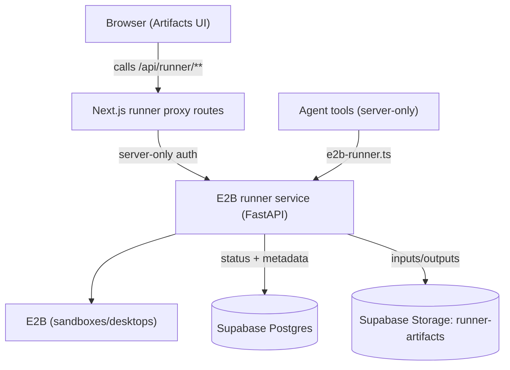

#### Production runner (AWS ECS/Fargate)

Deployment assets are committed in-repo:

- `e2b-runner-service/deploy/aws/runner-task-definition.template.json`
- `e2b-runner-service/deploy/aws/runner-service.template.json`
- `deploy/aws/env-secrets-mapping.md`
- `deploy/aws/iam-checklist.md`
- `deploy/aws/rollout-rollback-runbook.md`

Notes:
- The runner image contains **only** `e2b-runner-service/` (not the Next.js app).
- Keep the runner **server-only**; never expose tokens in client code.
- Interactive sessions are in-memory; keep **1 replica** or use sticky sessions.

#### Deployment flow (AWS ECS/Fargate)

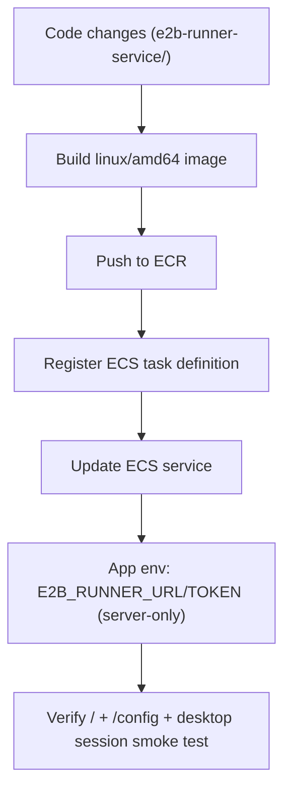

### MCP Connectors (optional)

This app can load **MCP (Model Context Protocol)** servers as additional agent tools (for example, CRMs, ticketing systems, internal APIs), without bundling credentials into the browser.

#### How it works

- **Tool names**: MCP tools are exposed to the agent as `mcp.<serverId>.<toolName>`.
- **Skill gating**: MCP tools are only offered to skills that either include `mcp_tools` (allow all enabled MCP tools) or explicitly list `mcp.<serverId>.<toolName>` entries in their `tools` array (allow only those tools).
- **User gating**: users choose which MCP servers are enabled (stored in `profiles.preferences.mcp.enabled_servers`).
- **Approval**: the first time a user-added MCP tool is invoked, the run will request user approval; approvals are stored in `user_mcp_tool_approvals`.

Server config ownership:
- MCP servers like `firecrawl-mcp` are configured server-side via `TUNA_MCP_SERVERS` (see `.env.example` and the examples below).
- Tool exposure is granted per-skill in `src/lib/agent/skills/*` by adding `mcp_tools` or explicit `mcp.<serverId>.<toolName>` entries to the skill's `tools` list.

#### MCP flow

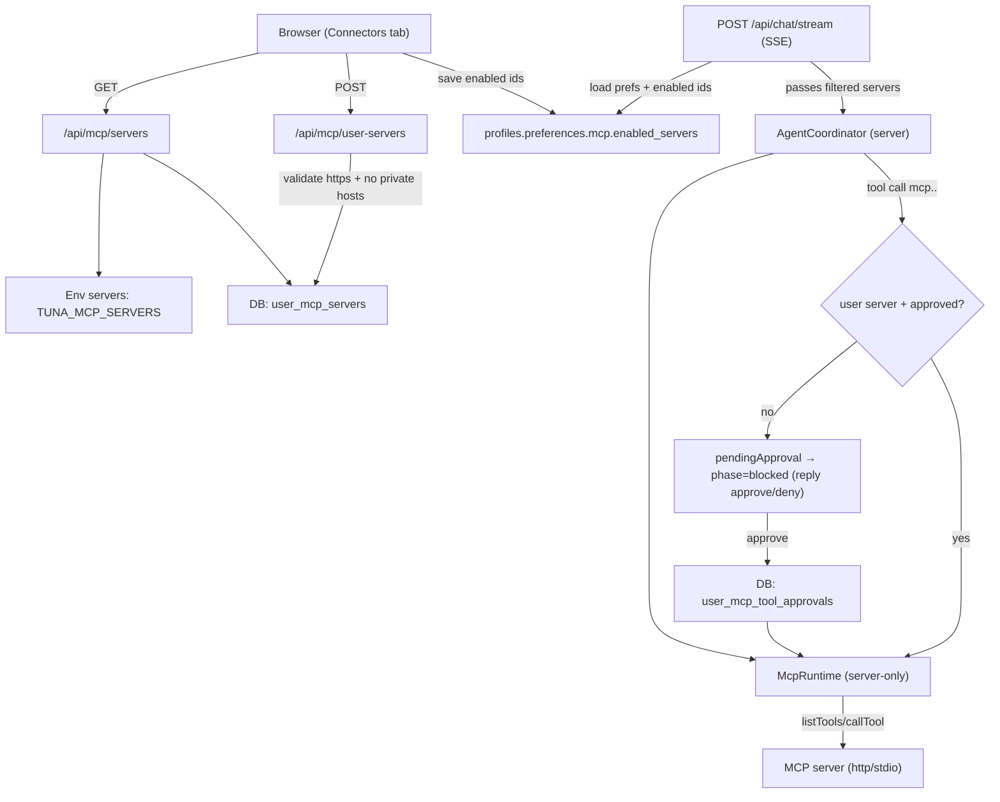

#### Configure servers via env (`TUNA_MCP_SERVERS`)

You can ship always-on servers via a server-only env var named **`TUNA_MCP_SERVERS`**. It must be valid JSON.

- Supported transports:
  - **`http`**: Streamable HTTP MCP server (recommended for production).
  - **`stdio`**: local process MCP server (usually local dev only; not recommended for serverless).

Example (HTTP):

```json
[
  {
    "id": "linear",
    "label": "Linear",
    "transport": "http",
    "url": "https://your-mcp-server.example.com/mcp",
    "headers": { "Authorization": "Bearer YOUR_TOKEN" }
  }
]
```

Example (stdio):

```json
[
  {
    "id": "local_tools",
    "label": "Local Tools",
    "transport": "stdio",
    "command": "node",
    "args": ["./path/to/mcp-server.js"],
    "env": { "SOME_VAR": "value" }
  }
]
```

Example (stdio, Firecrawl MCP):

```json
{
  "mcpServers": {
    "firecrawl-mcp": {
      "command": "npx",
      "args": ["-y", "firecrawl-mcp"],
      "env": { "FIRECRAWL_API_KEY": "$FIRECRAWL_API_KEY" }
    }
  }
}
```

Default enablement: new profiles enable `firecrawl-mcp` by default (override by setting `profiles.preferences.mcp.enabled_servers` to an empty array).

#### Add per-user servers (HTTPS only)

In the UI, users can add their own MCP servers (stored in `user_mcp_servers`) via `GET /api/mcp/servers` and `POST /api/mcp/user-servers`.

Security constraints enforced server-side:

- Only **`https://`** URLs are allowed.
- **No localhost/private networks** (SSRF protection).
- Headers are allowed but treated as sensitive (results/args are redacted before being persisted to artifacts).

### Integrations (optional)

This console supports per-user integration tokens and repo configuration for tools like Hugging Face Hub, Firecrawl, GitHub publishing, and Kaggle workflows.

#### Tokens

- **Per-user tokens** are stored in Supabase in `user_integrations` (`provider = huggingface | github | kaggle | firecrawl`).
- **Server-wide fallback tokens** can be provided via env: `HUGGINGFACE_TOKEN` / `HF_TOKEN`, `GITHUB_TOKEN`, `KAGGLE_TOKEN`, `FIRECRAWL_API_KEY`.
- Managing tokens requires `SUPABASE_SERVICE_ROLE_KEY` on the server because these tables are locked down by RLS (server uses the admin client).
- Firecrawl MCP (stdio) uses `FIRECRAWL_API_KEY` by default; if a user saves a Firecrawl integration token it overrides the server default for their runs.

API routes:

- `GET|POST|DELETE /api/integrations/:provider` (token status/save/remove)

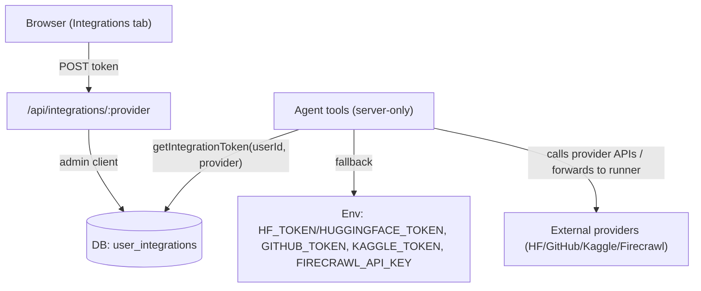

#### GitHub repo connections

For GitHub publishing tools, users can optionally save repo defaults in `integration_repo_connections`:

- `repo_full_name` (owner/repo)
- `base_branch` (e.g. `main`)
- `work_branch` (e.g. `tuna`)
- `default_publish_mode` (`pr` or `direct`)

API routes:

- `GET|POST /api/integrations/github/repos`
- `PATCH|DELETE /api/integrations/github/repos/:connectionId`

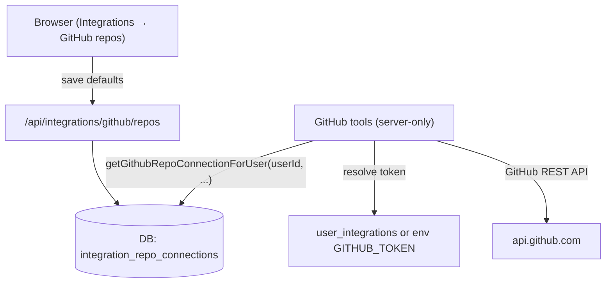

### Email notifications (optional)

Hosted deployments can send transactional emails via **Resend**:

- Welcome email: `POST /api/account/welcome` (records `profiles.preferences.comm.welcome_sent_at`)
- Queued-task started email: sent from the SSE run pipeline (rate-limited by `TUNA_QUEUED_TASK_START_EMAIL_COOLDOWN_MINUTES`)

Required env vars:

- `RESEND_API_KEY`
- `RESEND_FROM_EMAIL`
- `RESEND_FROM_NAME`

#### Email flow

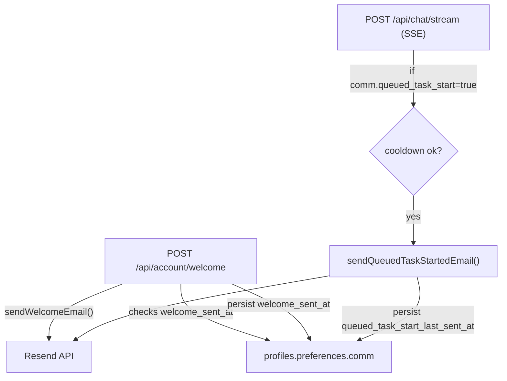

### Exa Web Search (optional)

The agent supports a server-side `web_search` tool powered by Exa.

#### Setup

Add this to `.env.local` (do **not** expose it to the client):

```env
EXA_API_KEY=YOUR_API_KEY
```

#### Browser fallback when `web_fetch` is insufficient (optional)

`web_search`/`web_fetch` use Exa Contents, which can be incomplete on some sites (paywalls, 403s, heavy client-side rendering, bot protection). If you run the optional runner service (see [E2B Runner Service](#e2b-runner-service)), the agent can escalate to a real browser:

- **`sandbox_browser`**: server-side rendering + extraction (HTML/text/screenshot) without GUI interaction.
- **Desktop sessions**: `desktop_start` + `desktop_action` to open Chrome/Chromium and navigate interactively; capture evidence with `desktop_screenshot`; always `desktop_stop` when finished.

Notes:
- Runner URLs/tokens remain server-only; the app proxies runner APIs under `/api/runner/**`.
- Do not enter credentials in desktop sessions; prefer public sources.
- This escalation is encoded in the default agent skills and is also available as the dynamic skill `web_research_desktop_fallback` (`src/lib/agent/skills/dynamic/web_research_desktop_fallback.json`).

### Dataset/model source policy (server-side)

The agent now supports deterministic source policy controls for dataset/model discovery:

- Dataset discovery enforces HF-first progression (Hugging Face first, then GitHub/Kaggle, then open-web fallback).
- OSS model selection can rank candidates with benchmark freshness signals (for example LMArena-style leaderboard evidence).
- Strict mode blocks off-policy domain overrides at tool-gate level.
- Desktop escalation tools are blocked until prior-tier fallback evidence exists for dataset/model discovery.
- Search outputs include executable usage hints for `training_submit` fields (`hfModels`, `hfDatasets`, `github`, `kaggleDatasets`) and Kaggle sandbox workflows.

Use these env vars to tune behavior (server-side only):

- `TUNA_AGENT_SOURCE_POLICY_STRICTNESS` (`off | prefer | strict`)
- `TUNA_AGENT_SOURCE_POLICY_FALLBACK_GOV`
- `TUNA_AGENT_SOURCE_POLICY_FALLBACK_OPEN_WEB`
- `TUNA_AGENT_SOURCE_POLICY_MIN_RESULTS_PER_TIER`
- `TUNA_AGENT_MODEL_BENCHMARK_MAX_AGE_DAYS`

See:

- `DATASET_SOURCE_POLICY.md`
- `MODEL_SELECTION_ROADMAP.md`

### API routes (overview)

All routes are implemented under `src/app/api/**` unless noted.

#### Chat + artifacts (`src/app/api/chat/**`)

- `POST /api/chat/stream`: run the agent and stream SSE events.
- `GET|POST /api/chat`: list/create chats.
- `GET|PATCH|DELETE /api/chat/:chatId`: fetch/update/delete a chat (delete also cleans up Storage prefixes).
- `GET|POST|PUT /api/chat/:chatId/messages`: list/add/upsert messages (including `files.storagePath`).
- `GET|POST /api/chat/:chatId/runs`: get the active run or create a run row.
- `POST /api/chat/:chatId/stop`: request stop for an active run.
- `GET /api/chat/state/:chatId`: fetch `agent_states` (artifacts + canvas timeline).
- `POST /api/chat/title`: generate a chat title.
- `POST /api/chat/artifacts/upsert`: persist Canvas edits back into `agent_states`.
- `POST /api/chat/artifacts/export`: export artifacts (docx/xlsx) into Storage.
- `POST /api/chat/share`: create a share snapshot.
- `GET /api/chat/:chatId/files`: list chat file inventory (uploads + artifacts).

#### Storage (`src/app/api/storage/**`)

- `POST /api/storage/upload`: upload a file to `uploads` (multipart `FormData`).
- `POST /api/storage/download`: download from `uploads` (returns bytes with `Content-Disposition`).
- `POST /api/storage/signed-url`: get a signed URL for a chat-owned object (`uploads/*` or `artifacts/exports/*` and `artifacts/runner-outputs/*`).
- `POST /api/storage/{copy,move,delete,update-text}`: file ops within allowed prefixes (used by Files Drawer).

#### Runner proxies (`src/app/api/runner/**`)

- Sandbox sessions: `/api/runner/sessions/:sessionId/**` (events/status/files/commands/pty/persist).
- Training tasks: `GET /api/runner/tasks/:taskId/status`, `GET /api/runner/download`.
- Desktop sessions: `/api/runner/desktop/sessions/**` (create/actions/screenshot/stream/close/events).

#### Sharing (`src/app/api/share/**`)

- `GET /api/share/:shareId`: read an immutable snapshot for `/share/:shareId`.
- `GET /api/share/:shareId/storage`: stream shared artifact bytes from Storage (exports + runner outputs only).

#### Integrations (`src/app/api/integrations/**`)

- `GET|POST|DELETE /api/integrations/:provider`: token status/save/remove.
- `GET|POST /api/integrations/github/repos`: repo connections.
- `PATCH|DELETE /api/integrations/github/repos/:connectionId`: update/remove a connection.

#### MCP (`src/app/api/mcp/**`)

- `GET /api/mcp/servers`: list env + per-user MCP servers.
- `POST /api/mcp/user-servers`: create per-user server.
- `PATCH|DELETE /api/mcp/user-servers/:serverId`: update/delete per-user server.

#### Billing (`src/app/api/billing/**`)

- `POST /api/billing/checkout`: create Stripe checkout session.
- `POST /api/billing/portal`: create Stripe customer portal session.
- `POST /api/billing/webhook`: Stripe webhook handler (server-only secrets required).

#### Account, runs, and auth

- `POST /api/account/welcome`: send welcome email (optional Resend integration).
- `POST /api/account/delete`: delete account + owned data.
- `PATCH /api/runs/:runId`: patch run status/error from the client.
- Supabase auth routes (not under `/api`): `src/app/auth/callback/route.ts`, `src/app/auth/confirm/route.ts`.

### Subsystems

#### Auth + onboarding gate

Route access is enforced by Edge middleware (`src/middleware.ts` → `src/lib/supabase/middleware.ts`):

- Refreshes Supabase sessions on every request (cookie-based).
- Redirects unauthenticated users to `/login` (except `/api/*` and `/share/*`).
- Redirects authenticated users to `/onboarding` until `profiles.onboarding_completed = true`.

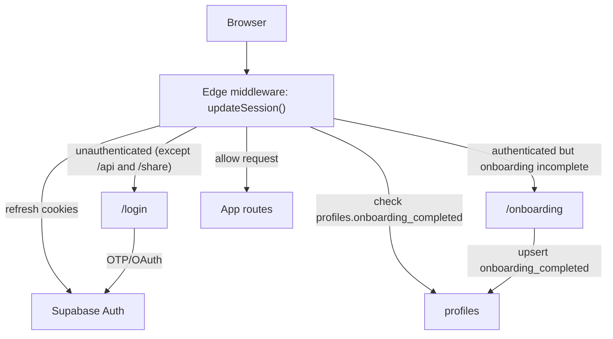

#### Onboarding personalization

The onboarding wizard persists user preferences to `profiles.full_name` and `profiles.preferences` (JSONB), and those values are used to shape the agent context.

- **Collection**: `src/app/onboarding/page.tsx` collects name + optional personalization (nickname, occupation, role, company, industry, experience, region, primary use case, goal, default mode, custom instructions, comm prefs).
- **Consumption**: server request handlers parse these preferences into `ProjectContext.userProfile` via `src/lib/profile/profile-context.ts` (goal/experience IDs are mapped to human labels for prompts).
- **Edit paths**: `/onboarding?edit=1` and the Settings modal (Credits/Personalization) both update the same `profiles.preferences` JSON.

#### Chat streaming (SSE) + persistence

The client sends a message via `POST /api/chat/stream` and reads an SSE stream. The server runs the agent and emits incremental events the UI consumes.

- **Request payload** (client → server): `message`, `history`, `chatId`, optional `reasoningEffort`, optional `files` metadata.
- **SSE events** (server → client): `ping`, `status`, `context`, `reasoning_summary`, `ui_upsert`, `ui_open`, `content`, `usage`, `done`, `error`.
  - `ping`: heartbeat (keeps the SSE connection alive).
  - `usage`: emitted at the end of successful runs; includes token usage + computed credits summary for the UI.
- **Persistence**:
  - `messages`: user + assistant messages (assistant message is upserted incrementally during streaming).
  - `agent_runs`: run status (`running|done|failed`).
  - `agent_states`: durable per-chat agent state (artifacts + Canvas timeline + context usage).

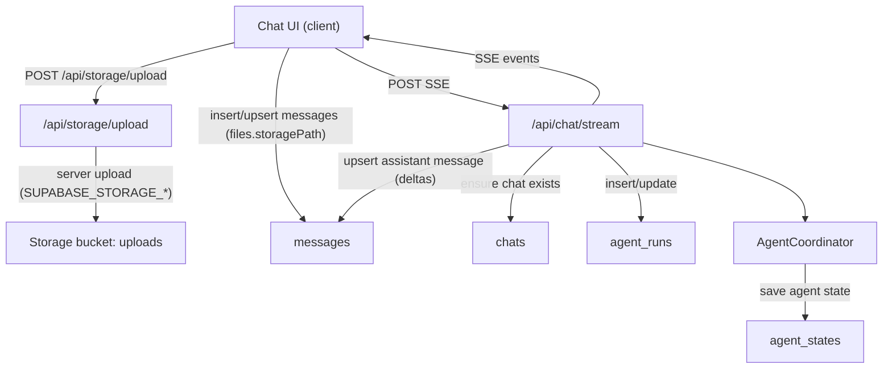

#### Interaction semantics

- When a run is active, new messages are queued and sent in order once the run finishes.
- The Send button stays enabled while a run is active, and the UI shows a queued count.

#### File retention

- Uploaded files live in the `uploads` bucket under `<userId>/<chatId>/<fileId>-<safeName>` and are referenced by `messages.files.storagePath`.
- Exported artifacts are stored in the `artifacts` bucket under `exports/<chatId>/`.
- Runner/tool outputs are stored in the `artifacts` bucket under `runner-outputs/<chatId>/` (private).
- Deleting a chat removes its database records and cleans up:
  - `uploads/<userId>/<chatId>/...`
  - `artifacts/exports/<chatId>/...`
  - `artifacts/runner-outputs/<chatId>/...`

#### Agent loop (skills + tools + memory)

`AgentCoordinator.processMessage()` (server-only) is the core orchestration loop:

- Loads prior `AgentState` (or initializes a new one).
- Optionally runs a **first-turn intent pipeline** in `autonomous` mode (creates an `intent` artifact).
- Builds the system prompt (security preamble + active skill prompt + capability inventory + plan + memory).
- Loads skills/tools from the **capability registry** (built-in TS skills + dynamic JSON skills).
- Streams Azure OpenAI output and tool calls.
- Executes tool calls with strict **skill allowlists** and **path security gates** (e.g. blocks `.env*`, `.git/*`, `.tuna/*`, `node_modules/*`).
- Applies tool side effects (plan updates + artifact upserts/opens), verifies invariants, and persists updated state.

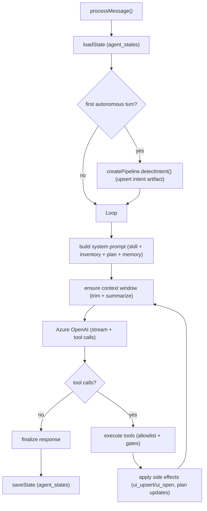

#### Artifacts + Canvas timeline (replay/scrub)

Artifacts are durable, per-chat UI objects stored in `agent_states.state`:

- `state.artifacts`: the current set of artifacts (plan, research, document, spreadsheet, sandbox, etc.).
- `state.ui.canvasTimeline`: a sequence of “frames” representing upserts/opens over time (used for Canvas replay and scrubbing).

The UI can be updated from both directions:

- **Agent-driven**: tools emit side effects → server streams `ui_upsert` / `ui_open` events to the client.
- **User-driven**: Canvas editors call `POST /api/chat/artifacts/upsert` to persist edits back into `agent_states`.

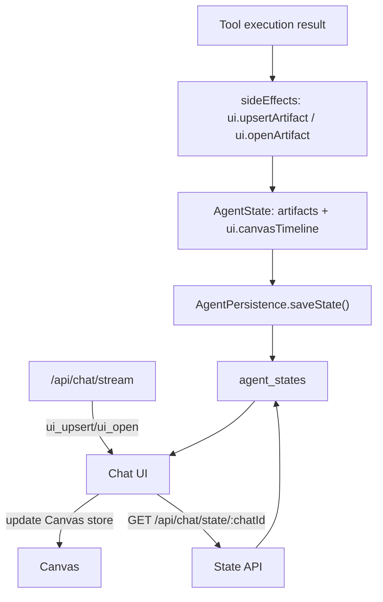

#### Runner integration (sandbox / training / desktop)

Interactive sandboxes/training tasks/desktop sessions are executed out-of-process by the runner service (`e2b-runner-service/`). The Next.js app exposes authenticated, chat-owned proxies under `src/app/api/runner/**`, and the agent can also call the runner from server-only tools (`src/lib/agent/tools/e2b-runner.ts`).

- Runner URL/token are server-only env vars (`E2B_RUNNER_URL`, `E2B_RUNNER_TOKEN`).
- UI artifacts poll the proxy endpoints for live updates (events, status, screenshots, downloads).

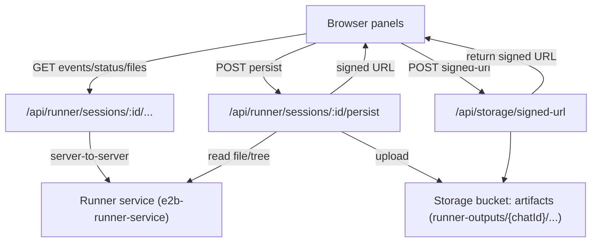

#### Export + Storage (uploads vs exports)

There are two main Storage flows:

- **Uploads (client → server)**: attachments are uploaded from the browser to `POST /api/storage/upload`; the server authenticates the user and writes to the `uploads` bucket via the S3-compatible Storage API (`SUPABASE_STORAGE_*`). The returned `storagePath` is stored alongside the message metadata (`messages.files.storagePath`).
- **Exports (server)**: document/spreadsheet exports are generated server-side and uploaded to the `artifacts` bucket via the S3-compatible Storage API, then returned as a signed URL.

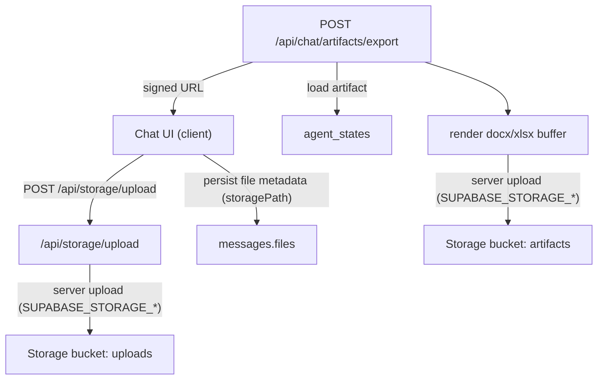

#### Storage access via `/api/storage/**` (Files Drawer)

The `FilesDrawer` UI uses server routes under `/api/storage/**` to browse, edit, and download chat-owned files without exposing Storage credentials to the browser. These routes enforce chat ownership + allowed storage prefixes (`uploads/<userId>/<chatId>/...`, `artifacts/exports/<chatId>/...`, `artifacts/runner-outputs/<chatId>/...`) and apply size caps (for example `FILES_DRAWER_MAX_EDIT_BYTES`).

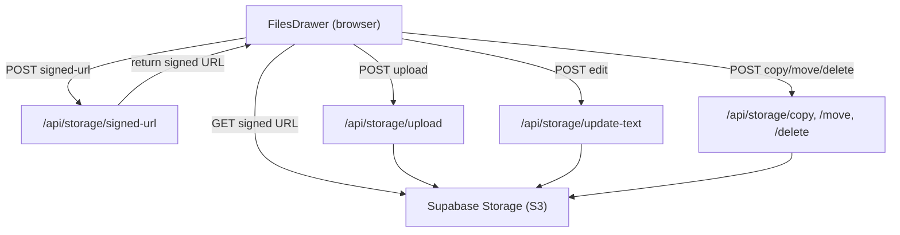

#### Sharing (public snapshot + replay)

Sharing produces an immutable snapshot (chat + messages + state) stored in `chat_shares.snapshot`:

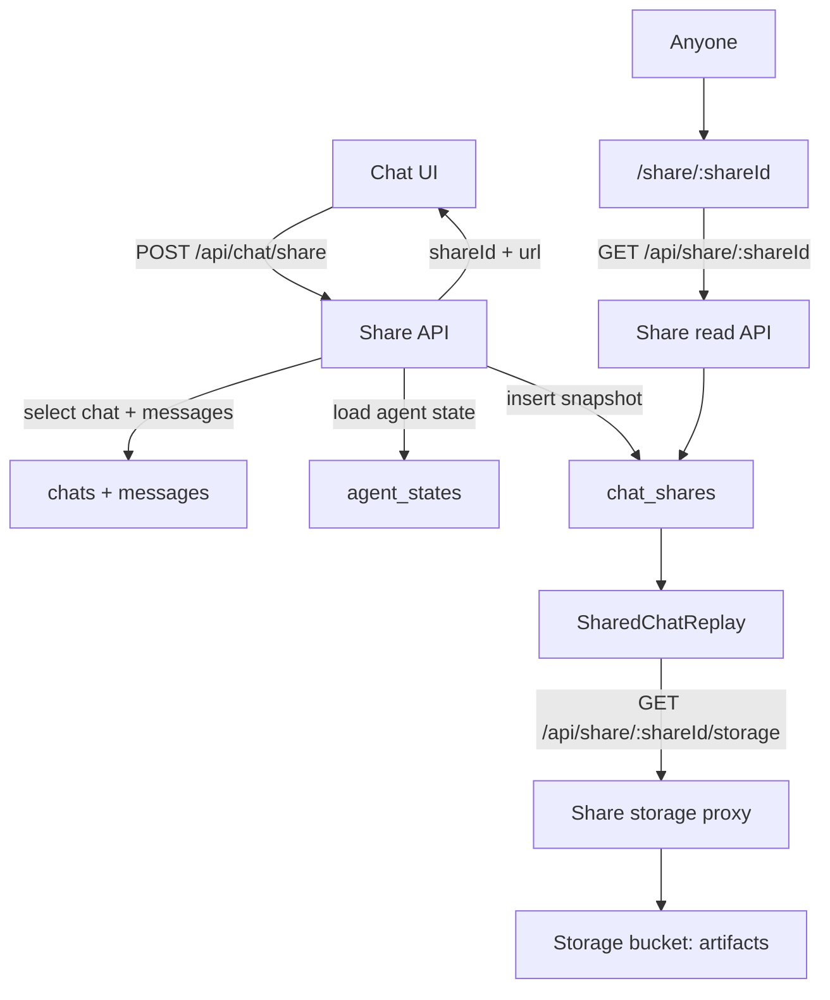

#### Optional: first-turn intent pipeline

On the first assistant turn in `autonomous` mode, the coordinator runs a lightweight pipeline to extract intent and stores it as an `intent` artifact (usually hidden from the main transcript but available on the Canvas):

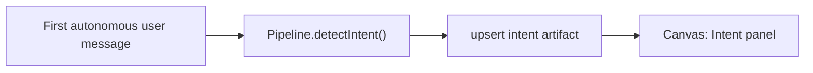

### Data model (high level)

Authoritative schema lives in `supabase/schema.sql`. The current console primarily uses:

- **`profiles`**: onboarding gate (`onboarding_completed`).
- **`chats`**: chat threads (per user).
- **`messages`**: transcript + attachment metadata + rich JSON fields for status/trace/reasoning.
- **`agent_states`**: durable per-chat JSON state (artifacts + Canvas timeline + context usage).
- **`agent_runs`**: run tracking (`running|done|failed`).
- **`chat_shares`**: public snapshot payloads for `/share/:shareId`.
- **Integrations**: `user_integrations` (per-user tokens), `integration_repo_connections` (GitHub repo defaults).
- **MCP connectors**: `user_mcp_servers` (per-user servers), `user_mcp_tool_approvals` (per-tool approvals).
- **Billing**: `billing_accounts`, `credit_ledger`, `billing_rates`, `billing_skus`, `billing_customers`, `billing_subscriptions`.
- **Storage buckets**: `uploads` (attachments) and `artifacts` (exports).

#### Database tables (overview)

Main app tables are created in the **`public`** schema by `supabase/schema.sql`:

| Table | Purpose | Access notes |
|------|---------|--------------|
| `profiles` | User profile + `preferences` (includes MCP enablement) + onboarding gate | Public `SELECT`; users can `INSERT`/`UPDATE` their own row |
| `chats` | Chat threads | User-scoped via RLS (`user_id`) |
| `messages` | Transcript + attachment metadata (`files`) + status/trace fields | User-scoped via parent `chats` |
| `agent_states` | Durable per-chat JSON state (artifacts + canvas timeline) | User-scoped via parent `chats` |
| `agent_runs` | Run rows (`running|done|failed|cancelled`) | User-scoped via parent `chats` |
| `chat_shares` | Immutable public share snapshots | Owners can manage; public can `SELECT` active public shares |
| `integration_repo_connections` | GitHub repo defaults (base/work branch, publish mode) | User-scoped via RLS |
| `user_integrations` | Per-user integration tokens (HF/GitHub/Kaggle/etc) | **Service-role only** (privileges revoked from `anon`/`authenticated`) |
| `user_mcp_servers` | Per-user MCP server configs | **Service-role only** |
| `user_mcp_tool_approvals` | Per-user MCP tool approvals | **Service-role only** |
| `billing_accounts` | Credits balance + plan/status | Users can `SELECT` own; balance mutations happen via RPCs / server |
| `credit_ledger` | Immutable credits ledger entries | Users can `SELECT` own; inserts happen via RPCs / server |
| `billing_rates` | Provider/model → credits-per-token rate card | **Service-role only** |
| `billing_skus` | Stripe price IDs → SKU kind + credits mapping | **Service-role only** |
| `billing_customers` | User ↔ Stripe customer ID | **Service-role only** |
| `billing_subscriptions` | Stripe subscription status | Users can `SELECT` own; server upserts |
| `e2b_session_meters` | Server-side metering for sandbox sessions | **Service-role only** |
| `e2b_training_task_meters` | Server-side metering for training tasks | **Service-role only** |

Additional schemas you’ll see in Supabase:

- **`storage`**: Supabase Storage metadata (for example `storage.buckets` and `storage.objects`). This repo seeds buckets `uploads` + `artifacts` in `supabase/schema.sql`.
- **Runner service (optional)**: if you deploy `e2b-runner-service`, apply `e2b-runner-service/supabase_schema.sql` to add `public.runner_tasks`.

RLS is enabled on the core tables so user sessions (anon key + cookies) are the main access boundary.

#### Database architecture (full)
Source-of-truth: `supabase/schema.sql` (plus optional `e2b-runner-service/supabase_schema.sql` for runner tasks). This section enumerates every table, relationship, and database-level primitive defined in that schema.

Schemas & buckets:
- `auth`: Supabase-managed users table (`auth.users`) referenced by most user-scoped tables.
- `public`: Application tables, RPCs, and triggers defined in `supabase/schema.sql`.
- `storage`: Supabase Storage metadata + policies; buckets seeded: `uploads`, `artifacts`.
- Optional runner extension: `public.runner_tasks` from `e2b-runner-service/supabase_schema.sql`.

```mermaid
erDiagram
  AUTH_USERS ||--|| PROFILES : "id"
  AUTH_USERS ||--o{ USER_INTEGRATIONS : "user_id"
  AUTH_USERS ||--o{ USER_MCP_SERVERS : "user_id"
  AUTH_USERS ||--o{ USER_MCP_TOOL_APPROVALS : "user_id"
  AUTH_USERS ||--o{ INTEGRATION_REPO_CONNECTIONS : "user_id"
  AUTH_USERS ||--o{ CHATS : "user_id"
  AUTH_USERS ||--o{ CHAT_SHARES : "owner_id"
  AUTH_USERS ||--|| BILLING_ACCOUNTS : "user_id"
  AUTH_USERS ||--|| BILLING_CUSTOMERS : "user_id"
  AUTH_USERS ||--o{ BILLING_SUBSCRIPTIONS : "user_id"
  AUTH_USERS ||--o{ CREDIT_LEDGER : "user_id"
  AUTH_USERS ||--o{ E2B_SESSION_METERS : "user_id"
  AUTH_USERS ||--o{ E2B_TRAINING_TASK_METERS : "user_id"

  USER_MCP_SERVERS ||--o{ USER_MCP_TOOL_APPROVALS : "server_id"

  CHATS ||--o{ MESSAGES : "chat_id"
  CHATS ||--|| AGENT_STATES : "chat_id"
  CHATS ||--o{ AGENT_RUNS : "chat_id"
  CHATS ||--o{ CHAT_SHARES : "chat_id"
  CHATS ||--o{ CREDIT_LEDGER : "chat_id"
  CHATS ||--o{ E2B_SESSION_METERS : "chat_id"
  CHATS ||--o{ E2B_TRAINING_TASK_METERS : "chat_id"
  AGENT_RUNS ||--o{ CREDIT_LEDGER : "run_id"

  PROFILES ||--o{ PROJECTS : "user_id"
  PROJECTS ||--o{ UPLOADED_FILES : "project_id"
  PROJECTS ||--|| EDA_RESULTS : "project_id"
  PROJECTS ||--|| TRAINING_GOALS : "project_id"
  PROJECTS ||--o{ TRAINING_JOBS : "project_id"
  PROJECTS ||--o{ RESEARCH_SOURCES : "project_id"
  TRAINING_JOBS ||--o{ TRAINING_CHECKPOINTS : "job_id"
  TRAINING_JOBS ||--o{ MODEL_ARTIFACTS : "job_id"

  AUTH_USERS {
    uuid id PK
  }
  PROFILES {
    uuid id PK
    jsonb preferences
    boolean onboarding_completed
  }
  USER_INTEGRATIONS {
    uuid user_id
    text provider PK
  }
  USER_MCP_SERVERS {
    uuid id PK
    uuid user_id
  }
  USER_MCP_TOOL_APPROVALS {
    uuid user_id PK
    uuid server_id PK
    text tool_name PK
  }
  INTEGRATION_REPO_CONNECTIONS {
    uuid id PK
    uuid user_id
  }
  CHATS {
    uuid id PK
    uuid user_id
  }
  MESSAGES {
    uuid id PK
    uuid chat_id
  }
  AGENT_STATES {
    uuid chat_id PK
  }
  AGENT_RUNS {
    uuid id PK
    uuid chat_id
  }
  CHAT_SHARES {
    uuid share_id PK
    uuid chat_id
    uuid owner_id
  }
  BILLING_ACCOUNTS {
    uuid user_id PK
  }
  BILLING_CUSTOMERS {
    uuid user_id PK
  }
  BILLING_SUBSCRIPTIONS {
    uuid id PK
    uuid user_id
  }
  BILLING_RATES {
    uuid id PK
    text provider
    text model
  }
  BILLING_SKUS {
    text stripe_price_id PK
  }
  CREDIT_LEDGER {
    uuid id PK
    uuid user_id
    uuid chat_id
    uuid run_id
  }
  E2B_SESSION_METERS {
    uuid session_id PK
    uuid user_id
    uuid chat_id
  }
  E2B_TRAINING_TASK_METERS {
    uuid task_id PK
    uuid user_id
    uuid chat_id
  }
  PROJECTS {
    uuid id PK
    uuid user_id
  }
  UPLOADED_FILES {
    uuid id PK
    uuid project_id
  }
  EDA_RESULTS {
    uuid id PK
    uuid project_id
  }
  TRAINING_GOALS {
    uuid id PK
    uuid project_id
  }
  TRAINING_JOBS {
    uuid id PK
    uuid project_id
  }
  TRAINING_CHECKPOINTS {
    uuid id PK
    uuid job_id
  }
  MODEL_ARTIFACTS {
    uuid id PK
    uuid job_id
  }
  RESEARCH_SOURCES {
    uuid id PK
    uuid project_id
  }
```

Full table inventory (public schema):
| Table | Keys + relationships | Purpose |
|------|----------------------|---------|
| `profiles` | `id` → `auth.users.id` | User profile, preferences, onboarding gate |
| `user_integrations` | PK `(user_id, provider)`; `user_id` → `auth.users.id` | Server-only integration tokens |
| `user_mcp_servers` | `id`; `user_id` → `auth.users.id` | Server-only MCP server configs |
| `user_mcp_tool_approvals` | PK `(user_id, server_id, tool_name)`; `user_id` → `auth.users.id`; `server_id` → `user_mcp_servers.id` | Server-only MCP tool approvals |
| `integration_repo_connections` | `id`; `user_id` → `auth.users.id` | Per-user repo defaults |
| `chats` | `id`; `user_id` → `auth.users.id` | Chat threads |
| `messages` | `id`; `chat_id` → `chats.id` | Transcript + attachments metadata |
| `agent_states` | `chat_id` (PK, FK → `chats.id`) | Durable per-chat agent state |
| `agent_runs` | `id`; `chat_id` → `chats.id` | Run tracking |
| `chat_shares` | `share_id`; `chat_id` → `chats.id`; `owner_id` → `auth.users.id` | Public share snapshots |
| `billing_accounts` | `user_id` (PK, FK → `auth.users.id`) | Credits balance + plan/status |
| `billing_customers` | `user_id` (PK, FK → `auth.users.id`) | Stripe customer id |
| `billing_subscriptions` | `id`; `user_id` → `auth.users.id` | Stripe subscription status |
| `billing_rates` | `id`; unique `(provider, model)` | Model pricing rate card |
| `billing_skus` | `stripe_price_id` (PK) | Stripe price → SKU mapping |
| `credit_ledger` | `id`; `user_id` → `auth.users.id`; `chat_id` → `chats.id`; `run_id` → `agent_runs.id` | Immutable credits ledger |
| `e2b_session_meters` | `session_id`; `user_id` → `auth.users.id`; `chat_id` → `chats.id` | Server-side sandbox metering |
| `e2b_training_task_meters` | `task_id`; `user_id` → `auth.users.id`; `chat_id` → `chats.id` | Server-side training metering |
| `projects` | `id`; `user_id` → `profiles.id` | Project workspace for training flows |
| `uploaded_files` | `id`; `project_id` → `projects.id` | Project file inventory |
| `eda_results` | `id`; `project_id` → `projects.id` (unique) | EDA results per project |
| `training_goals` | `id`; `project_id` → `projects.id` (unique) | Intent + training goals per project |
| `training_jobs` | `id`; `project_id` → `projects.id` | Training jobs + config |
| `training_checkpoints` | `id`; `job_id` → `training_jobs.id` | Checkpoints per job |
| `model_artifacts` | `id`; `job_id` → `training_jobs.id` | Model outputs per job |
| `research_sources` | `id`; `project_id` → `projects.id` | Research sources per project |

Storage schema (Supabase-managed):
| Table | Keys + relationships | Notes |
|------|----------------------|------|
| `storage.buckets` | `id` | Seeded with `uploads` and `artifacts` |
| `storage.objects` | `bucket_id`, `owner` | Policies restrict to bucket + owner |

Functions, triggers, and publications:
| Item | Scope | Notes |
|------|-------|------|
| `handle_new_user()` + trigger `on_auth_user_created` | `auth.users` → `public.profiles` | Auto-creates profile row on signup |
| `update_updated_at_column()` + `update_*_updated_at` triggers | Multiple public tables | Keeps `updated_at` fresh on update |
| `get_credit_balance()` | RPC | Returns credits balance; initializes daily credits |
| `get_credit_summary()` | RPC | Returns daily + base credits summary |
| `consume_credits()` | RPC | Deducts credits for authenticated users |
| `consume_credits_for_user()` | RPC | Service-role-only deduction for a user |
| `bill_e2b_session_minutes()` | RPC | Service-role-only sandbox metering |
| `grant_credits()` | RPC | Service-role-only credit grants |
| `supabase_realtime` publication | `messages`, `agent_runs` | Realtime subscriptions |

RLS notes:
- RLS is enabled on all core tables; user-scoped tables gate by `auth.uid()`.
- Server-only tables (no authenticated/anon policies) include `user_integrations`, `user_mcp_servers`, `user_mcp_tool_approvals`, `billing_rates`, `billing_skus`, and the E2B meter tables.
- Storage policies gate `uploads`/`artifacts` access by bucket + owner.

### Configuration & secrets (names only)

**Client-exposed (bundled in the browser)**:

- `NEXT_PUBLIC_SUPABASE_URL`
- `NEXT_PUBLIC_SUPABASE_ANON_KEY`
- `NEXT_PUBLIC_APP_URL`
- `NEXT_PUBLIC_STRIPE_SUBSCRIPTION_PRICE_ID` (Stripe price id for subscription checkout)
- `NEXT_PUBLIC_STRIPE_TOPUP_PRICE_ID` (Stripe price id for top-up packs)

**Server-only secrets / config** (never use `NEXT_PUBLIC_*`):

- **Azure OpenAI**: `AZURE_OPENAI_ENDPOINT`, `AZURE_OPENAI_API_KEY` (or `AZURE_OPENAI_AUTH_TOKEN`), `AZURE_OPENAI_DEPLOYMENT_NAME`, `AZURE_OPENAI_API_VERSION`
- **LLM provider selector**: `TUNA_LLM_PROVIDER` (`aws_bedrock | azure_openai | openai`; defaults to `aws_bedrock`)
- **AWS Bedrock (when selected)**: `AWS_REGION`, `AWS_BEDROCK_MODEL_ID` (+ AWS credentials/role via runtime)
- **SageMaker + Weights & Biases (training path)**: `SAGEMAKER_EXECUTION_ROLE_ARN`, `SAGEMAKER_TRAINING_IMAGE_URI`, `SAGEMAKER_OUTPUT_S3_URI`, `WANDB_API_KEY`, `WANDB_PROJECT`, `WANDB_ENTITY`
- **Web search (optional)**: `EXA_API_KEY`
- **MCP connectors (optional)**: `TUNA_MCP_SERVERS` (JSON; see section above)
- **Integrations token fallbacks (optional)**: `HUGGINGFACE_TOKEN` / `HF_TOKEN`, `GITHUB_TOKEN`, `KAGGLE_TOKEN`
- **E2B runner (sandbox/training/desktop)**: `E2B_RUNNER_URL`, `E2B_RUNNER_TOKEN`, `E2B_RUNNER_TIMEOUT_MS`, `RUNNER_SIGNED_URL_TTL_SECONDS`, `RUNNER_MODEL_COPY_MAX_BYTES`, `RUNNER_SANDBOX_OUTPUT_MAX_CHARS`, `RUNNER_DESKTOP_*` (see `.env.example`)
- **Supabase Storage S3 API (exports/tools)**: `SUPABASE_STORAGE_URL`, `SUPABASE_STORAGE_REGION`, `SUPABASE_STORAGE_KEY_ID`, `SUPABASE_STORAGE_SECRET`
- **Agent budgets/tuning** (server-side): `TUNA_AGENT_MAX_RUN_MS`, `TUNA_AGENT_MAX_ITERATIONS`, `TUNA_AGENT_MAX_TOOL_CALLS_TOTAL`, `TUNA_AGENT_MAX_CONTEXT_TOKENS`, etc. (see `.env.example`)
- **Billing / credits**: `SUPABASE_SERVICE_ROLE_KEY`, `STRIPE_SECRET_KEY`, `STRIPE_WEBHOOK_SECRET`, `TUNA_MIN_CREDITS_TO_START`, `TUNA_MAX_CREDITS_PER_RUN`, `TUNA_E2B_SESSION_CREDITS_PER_MINUTE`, `TUNA_E2B_TRAINING_CREDITS_PER_MINUTE`
- **Email (optional)**: `RESEND_API_KEY`, `RESEND_FROM_EMAIL`, `RESEND_FROM_NAME`, `TUNA_QUEUED_TASK_START_EMAIL_COOLDOWN_MINUTES`

Naming guardrails:
- Do not add new legacy alias variables.
- Do not add old-brand-named assets or docs.
- If a temporary compatibility alias is absolutely required, add a sunset/removal note.

**Azure endpoint shapes used by this repo** (placeholders only):

- **Deployment-scoped Chat Completions**: `POST {AZURE_OPENAI_ENDPOINT}/openai/deployments/{AZURE_OPENAI_DEPLOYMENT_NAME}/chat/completions?api-version={AZURE_OPENAI_API_VERSION}`
- **OpenAI-compatible Responses**: `POST {AZURE_OPENAI_ENDPOINT}/openai/v1/responses`

`SUPABASE_SERVICE_ROLE_KEY` is used server-side for billing workflows (Stripe webhooks, SKU lookups). Never expose it to the client.

### Billing & credits

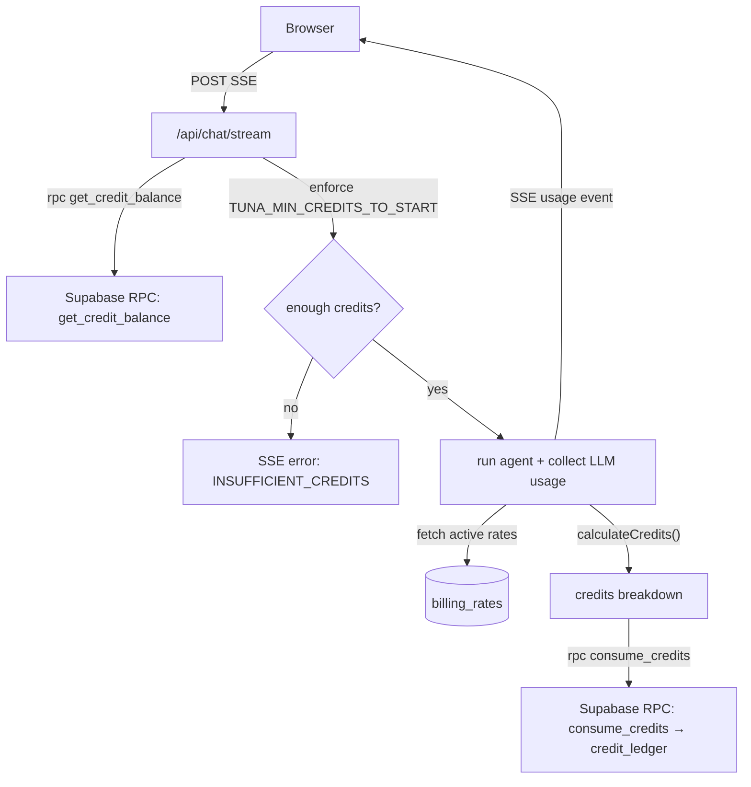

- **Credits are normalized**: usage → credits is computed from `billing_rates` (per provider/model).
- **Optional E2B metering**: set `TUNA_E2B_SESSION_CREDITS_PER_MINUTE` and/or `TUNA_E2B_TRAINING_CREDITS_PER_MINUTE` to charge per-minute for sandbox sessions and training tasks.
- **Subscription value**: subscriptions grant **2× credits per $** (webhook enforces the 2× rule).
- **Required DB seed data**:
  - `billing_rates`: one row per provider/model you run (e.g., `provider=azure_openai`, `model=<deployment_name>`).
  - `billing_skus`: map Stripe price IDs to `kind` (`subscription_monthly` or `topup_pack`) and `credits_base`. (`credits_multiplier` can be used for top-up packs; subscriptions are fixed at 2×.)
- **Testing default**: new accounts start with **5,000 credits** (no Stripe required during testing).
- **Default seed rate** (in `schema.sql`): `provider=azure_openai`, `model=gpt-5.2`, **1000 credits per 1M input/output tokens**. Update to match your deployment.
- **Stripe webhooks**: configure `POST /api/billing/webhook` and ensure `STRIPE_WEBHOOK_SECRET` is set.
- **Usage dashboard**: `/settings/usage` shows balance + recent ledger activity.
- **Enforcement knobs**: `TUNA_MIN_CREDITS_TO_START` (block when below) and `TUNA_MAX_CREDITS_PER_RUN` (per-run cap).
- **Best-effort settlement**: the server caps charges to the user's available credits so billing doesn't fail with `insufficient_credits` and leave balances unchanged. When usage exceeds balance, the ledger metadata records the shortfall (e.g. `unbilled_credits` / `insufficient_credits`) and the user is blocked on the next run when below `TUNA_MIN_CREDITS_TO_START`. E2B sandbox sessions bill as many minutes as affordable and return `blocked=insufficient_credits` when they can't keep up.
