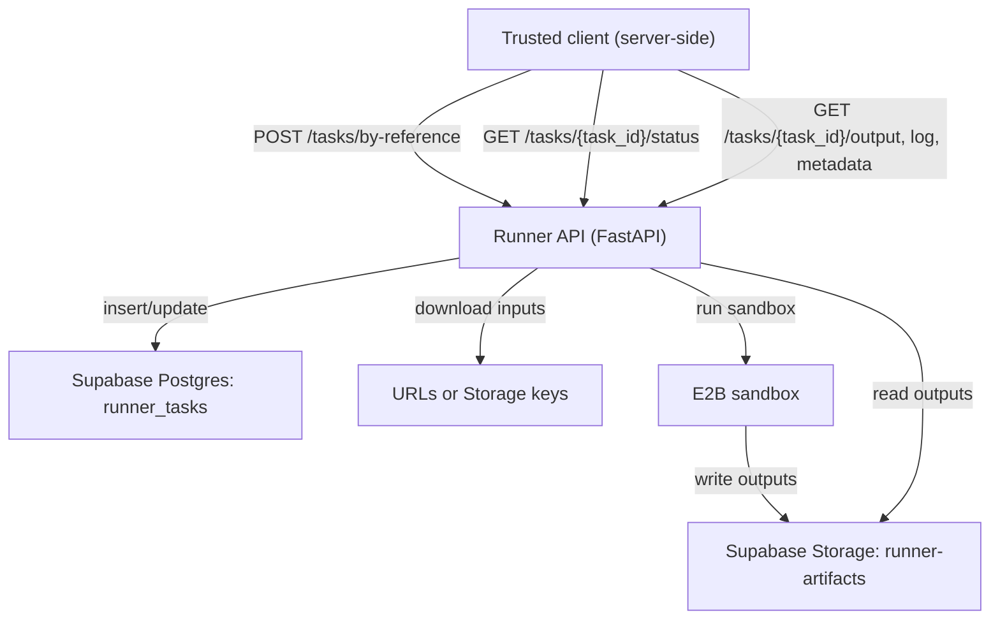
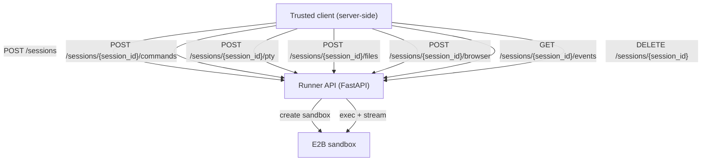

# E2B Runner Service

Standalone FastAPI microservice for running **CSV + Python training scripts** in E2B sandboxes. Used by the Tuna app (or any agent) to submit jobs, poll status, and download outputs. **Control-plane API**: status in **Supabase Postgres**, file I/O in **Supabase Storage** (bucket `runner-artifacts`).

---

## AWS ECS/Fargate deploy assets

Deploy-ready templates and runbooks are committed here:

- `e2b-runner-service/deploy/aws/runner-task-definition.template.json`
- `e2b-runner-service/deploy/aws/runner-service.template.json`
- `deploy/aws/env-secrets-mapping.md`
- `deploy/aws/iam-checklist.md`
- `deploy/aws/rollout-rollback-runbook.md`

---

## For agent authors: integrating with this service

This section is for anyone building an agent (or client) that submits training jobs and retrieves results. Use it as the single source of truth for endpoints and payloads.

### Base URL and flow

- **Base URL:** `http://localhost:8000` (dev) or your deployed URL (e.g. `https://runner.example.com`).
- **Auth (recommended):** Set `RUNNER_AUTH_TOKEN` and send `Authorization: Bearer <token>` (or `x-runner-token`) from trusted server-side clients.
- **Recommended flow:** Submit by **reference** (URLs or Storage keys) so the API stays lightweight; the service downloads inputs, runs in E2B, then writes outputs to Storage.

**High-level steps:**

1. **Submit** — `POST /tasks/by-reference` with CSV and script locations. You get a `task_id`.
2. **Poll** — `GET /tasks/{task_id}/status` until `status` is `completed` or `failed`.
3. **Download** — Use `GET /tasks/{task_id}/output`, `/output/log`, `/output/metadata` (or the combined `GET /tasks/{task_id}/download?file=...`) to fetch the model, run log, and metadata.



**Important:** Use **`POST /tasks/by-reference`** for JSON. Do **not** send JSON to `POST /tasks` — that endpoint accepts **multipart/form-data only** (file uploads). Sending JSON to `/tasks` will result in a 422.

---

### Endpoints: exact inputs and outputs

#### 1. Submit by reference (recommended for agents)

**`POST /tasks/by-reference`** — JSON only.

**Content-Type:** `application/json`

**Request body (JSON):**

| Field | Type | Required | Description |
|-------|------|----------|-------------|
| `csv_url` | string | Yes* | Public or signed URL of the CSV file. *Required if not using `csv_key`. (Backward compatible) |
| `script_url` | string | Yes* | Public or signed URL of the Python script (`.py`). *Required if not using `script_key`. |
| `csv_key` | string | Yes* | Storage key in bucket `runner-artifacts` (e.g. `inputs/.../input.csv`). Use with `script_key` instead of URLs. (Backward compatible) |
| `script_key` | string | Yes* | Storage key for the script in `runner-artifacts`. Use with `csv_key`. |
| `input_url` | string | Yes* | Public or signed URL of a generic input file (CSV/JSON/ZIP/etc). *Preferred over `csv_url`. |
| `input_key` | string | Yes* | Storage key for the generic input file in `runner-artifacts`. *Preferred over `csv_key`. |
| `input_name` | string | No | Filename to use inside the sandbox (defaults to inferred name or `input.csv`). |
| `extra_inputs` | array | No | Additional inputs: array of `{ name, url }` or `{ name, key }` entries. |
| `hf_models` | array | No | Hugging Face model repos to prefetch in sandbox before script run. Each item: `{ repo, revision?, allow_patterns?, ignore_patterns? }`. |
| `hf_datasets` | array | No | Hugging Face dataset repos to prefetch in sandbox before script run. Same item shape as `hf_models`. |
| `github_repos` | array | No | GitHub repos to prefetch in sandbox before script run. Each item: `{ repo, ref?, subdir?, include_paths?, exclude_paths? }`. |
| `kaggle_datasets` | array | No | Kaggle datasets to prefetch in sandbox before script run. Each item: `{ dataset, target_dir?, unzip? }`. |
| `hf_token` | string | No | Optional Hugging Face token for private/gated repos (server-side only). |
| `github_token` | string | No | Optional GitHub token for private repos and higher rate limits (server-side only). |
| `kaggle_token` | string | No | Optional Kaggle token (`username:key` or `kaggle.json`) used for prefetch when `kaggle_datasets` is provided. |
| `backend` | string | No | Requested training backend: `e2b` (default) or `sagemaker`. |
| `sagemaker` | object | No | Optional SageMaker execution config overrides. Example fields: `training_job_name`, `instance_type`, `output_s3_uri`, `hyperparameters`. |
| `wandb` | object | No | Optional Weights & Biases config. Example fields: `project`, `entity`, `run_name`, `tags`, `mode`, `config`. Runtime emits `run_id` / `run_url` when available. |
| `expected_output_name` | string | No | Filename the script is expected to produce (default: `model.pkl`). |
| `timeout_seconds` | integer | No | Optional timeout hint for the run. |

Current behavior: `backend=sagemaker` submits and monitors a real SageMaker training job, then records backend status and metadata in task outputs.

Phase 2 contract guardrails:
- `backend=e2b` must keep existing behavior.
- `backend=sagemaker` must run real SageMaker execution and expose backend status in `/tasks/{task_id}/status`.
- `wandb` fields are server-only metadata and must never include `WANDB_API_KEY` in responses.

**You must send either:**

- `input_url` **and** `script_url`, or  
- `input_key` **and** `script_key`.

`csv_url` / `csv_key` are accepted for backward compatibility.

**Example (URLs):**

```json
{
  "csv_url": "https://example.com/data.csv",
  "script_url": "https://example.com/train.py",
  "expected_output_name": "model.pkl"
}
```

**Example (generic input + extras):**

```json
{
  "input_url": "https://example.com/data.json",
  "input_name": "data.json",
  "script_url": "https://example.com/train.py",
  "extra_inputs": [
    { "name": "labels.json", "url": "https://example.com/labels.json" }
  ]
}
```

**Example (prefetch Hugging Face + GitHub into sandbox):**

```json
{
  "input_url": "https://example.com/data.jsonl",
  "script_url": "https://example.com/train.py",
  "hf_models": [
    { "repo": "distilbert/distilbert-base-uncased", "revision": "main" }
  ],
  "hf_datasets": [
    { "repo": "imdb", "allow_patterns": ["train*"] }
  ],
  "github_repos": [
    { "repo": "octocat/Hello-World", "ref": "main", "subdir": "examples" }
  ]
}
```

**Example (prefetch Kaggle dataset into sandbox):**

```json
{
  "input_url": "https://example.com/data.jsonl",
  "script_url": "https://example.com/train.py",
  "kaggle_datasets": [
    { "dataset": "zynicide/wine-reviews", "unzip": true }
  ]
}
```

**Example (SageMaker + W&B runtime config):**

```json
{
  "input_url": "https://example.com/data.jsonl",
  "script_url": "https://example.com/train.py",
  "backend": "sagemaker",
  "sagemaker": {
    "instance_type": "ml.g5.2xlarge",
    "instance_count": 1,
    "output_s3_uri": "s3://tuna-training-artifacts/runs/"
  },
  "wandb": {
    "project": "tuna",
    "entity": "hackathon-team",
    "tags": ["mistral", "qlora"]
  }
}
```

**Example (Storage keys):**

```json
{
  "csv_key": "inputs/abc-123/input.csv",
  "script_key": "inputs/abc-123/train.py"
}
```

**Response:** `202 Accepted`

```json
{ "task_id": "550e8400-e29b-41d4-a716-446655440000" }
```

**Errors:** `400` if neither URL pair nor key pair is provided, or if download from URLs/Storage fails.

---

#### 1a. Tuna agent tool: `training_submit` (inline payloads)

The Tuna app exposes a `training_submit` tool that accepts inline `text` / `base64` (or `url` / `storagePath`). Inline content is uploaded to Storage and converted into signed URLs before this service receives `POST /tasks/by-reference`.

`training_submit` also supports optional prefetch entries:
- `hfModels` / `hfDatasets` (camelCase in tool args, sent to runner as `hf_models` / `hf_datasets`)
- `github` (tool arg, sent to runner as `github_repos`)
- `kaggleDatasets` (tool arg, sent to runner as `kaggle_datasets`)
- `backend`, `sagemaker`, and `wandb` (sent as runtime backend/tracking config to the runner API)

When per-user integration tokens are configured in the app settings, the app forwards those tokens server-side as `hf_token` / `github_token` / `kaggle_token` for private resources.

**Minimal inline example (CSV + script):**

```json
{
  "input": {
    "name": "input.csv",
    "text": "x,y\n1,2\n3,4\n"
  },
  "script": {
    "name": "train.py",
    "text": "import argparse\nimport csv\nimport pickle\n\n\ndef parse_args():\n    parser = argparse.ArgumentParser()\n    parser.add_argument(\"--input\")\n    parser.add_argument(\"--csv\")\n    parser.add_argument(\"--out\", default=\"model.pkl\")\n    return parser.parse_args()\n\n\ndef main():\n    args = parse_args()\n    input_path = args.input or args.csv or \"input.csv\"\n    with open(input_path, newline=\"\") as f:\n        rows = list(csv.reader(f))\n    model = {\"rows\": len(rows)}\n    with open(args.out, \"wb\") as f:\n        pickle.dump(model, f)\n\n\nif __name__ == \"__main__\":\n    main()\n"
  },
  "expectedOutputName": "model.pkl",
  "timeoutSeconds": 600
}
```

---

#### 2. Submit with multipart upload (testing / small files)

**`POST /tasks`** — **Multipart only.** Do not send JSON here; use `POST /tasks/by-reference` for JSON.

**Content-Type:** `multipart/form-data`

**Form fields:**

| Field | Type | Required | Description |
|-------|------|----------|-------------|
| `csv` | file | Yes | CSV file (max 20MB). |
| `script` | file | Yes | Python script; must have a `.py` extension. |

**Response:** `202 Accepted`

```json
{ "task_id": "550e8400-e29b-41d4-a716-446655440000" }
```

**Errors:** `400` if `csv` or `script` is missing, script is not `.py`, or CSV exceeds 20MB.

---

#### 3. Get task status

**`GET /tasks/{task_id}/status`**

**Path parameter:** `task_id` — UUID returned from submit (e.g. `550e8400-e29b-41d4-a716-446655440000`).

**Response:** `200 OK`

```json
{
  "task_id": "550e8400-e29b-41d4-a716-446655440000",
  "status": "pending | running | completed | failed",
  "created_at": "2025-02-08T12:00:00Z",
  "updated_at": "2025-02-08T12:05:00Z",
  "input_csv_key": "inputs/.../input.csv",
  "script_key": "inputs/.../train.py",
  "output_model_key": "outputs/.../model.pkl",
  "run_log_key": "outputs/.../run.log",
  "error_message": null,
  "attempts": 1,
  "stdout": "...",
  "stderr": "...",
  "requested_backend": "sagemaker",
  "execution_backend": "sagemaker",
  "backend_job_id": "tuna-a1b2c3d4-1730456112",
  "backend_status": "InProgress:Training",
  "output_metadata_key": "outputs/.../metadata.json"
}
```

- **Poll** until `status` is `completed` or `failed`.  
- `stdout` / `stderr` are truncated in the DB; full log is in `run.log` (see download endpoints).  
- **Errors:** `404` if `task_id` is unknown.

---

#### 4. Download output model (binary)

**`GET /tasks/{task_id}/output`**

**Path parameter:** `task_id` — UUID.

**Response:** `200 OK` — binary body (e.g. `model.pkl`).  
Headers: `Content-Disposition: attachment; filename="model.pkl"` (or actual filename).

**Errors:** `404` task not found; `400` if task is not `completed` or has no output model.

---

#### 5. Download full run log (text)

**`GET /tasks/{task_id}/output/log`**

**Path parameter:** `task_id` — UUID.

**Response:** `200 OK` — plain text (`run.log`).  
Available after the run **completes or fails**.

**Errors:** `404` if task or log not found.

---

#### 6. Get metadata (JSON)

**`GET /tasks/{task_id}/output/metadata`**

**Path parameter:** `task_id` — UUID.

**Response:** `200 OK` — JSON body, e.g.:

```json
{
  "task_id": "550e8400-e29b-41d4-a716-446655440000",
  "status": "completed",
  "attempts": 1,
  "model_local_path": "/code/model.pkl",
  "produced_files": ["model.pkl"],
  "applied_patches_count": 0,
  "requested_backend": "sagemaker",
  "execution_backend": "sagemaker",
  "backend_job_id": "tuna-a1b2c3d4-1730456112",
  "sagemaker": {
    "training_job_name": "tuna-a1b2c3d4-1730456112",
    "final_status": "Completed",
    "model_artifact_s3_uri": "s3://.../output/model.tar.gz"
  }
}
```

**Errors:** `404` task not found; `400` if task is not `completed`.

---

#### 7. Single download endpoint (convenience)

**`GET /tasks/{task_id}/download?file=model|log|metadata`**

**Path parameter:** `task_id` — UUID.  
**Query parameter:** `file` — one of `model`, `log`, `metadata`.

- `file=model` — same as `GET /tasks/{task_id}/output` (binary).
- `file=log` — same as `GET /tasks/{task_id}/output/log` (text).
- `file=metadata` — same as `GET /tasks/{task_id}/output/metadata` (JSON).

**Errors:** `400` if `file` is not `model`, `log`, or `metadata`; otherwise same as the dedicated endpoints above.

---

#### 8. Config (optional)

**`GET /config`**

**Response:** `200 OK`

```json
{ "supabase_configured": true }
```

Use this to detect if the service is using Supabase (persistence) or local-only mode.

---

### Input and output layout (for agents)

**What you provide**

- **CSV:** Any CSV the script will read (e.g. `input.csv`). Max 20MB when using multipart or URL download.
- **Script:** A single `.py` file that:
  - Reads the CSV (e.g. from a path or from the same directory as the CSV).
  - Trains a model and writes it to a file (e.g. `model.pkl`). The default expected filename is `model.pkl`; override with `expected_output_name` if different.

**Where the service stores files (Storage bucket `runner-artifacts`)**

- **Inputs:** `inputs/<task_id>/input.csv`, `inputs/<task_id>/train.py`
- **Outputs:** `outputs/<task_id>/model.pkl` (or your `expected_output_name`), `outputs/<task_id>/run.log`, `outputs/<task_id>/metadata.json`

If you upload to Storage yourself, use these key patterns so the service can find them when you submit with `csv_key` and `script_key`.

---

### Quick checklist for agent implementers

1. **Submit:** Call `POST /tasks/by-reference` with a **JSON** body (`csv_url`+`script_url` or `csv_key`+`script_key`). Do not POST JSON to `/tasks` (that endpoint is multipart only; you would get 422). Store `task_id` from the response.
2. **Poll:** Call `GET /tasks/{task_id}/status` on an interval (e.g. every 2–5 s) until `status` is `completed` or `failed`.
3. **On success:** Download model via `GET /tasks/{task_id}/output` (or `.../download?file=model`); optionally fetch `.../output/log` and `.../output/metadata`.
4. **On failure:** Use `GET /tasks/{task_id}/output/log` to get the full run log; use `error_message` and `stderr` from status for a short summary.

---

## How it works (overview)

1. **Submit** — Client (or agent) sends CSV + script by reference (URLs or Storage keys) or by multipart upload. The API creates a task in Postgres and enqueues an E2B run in the background.
2. **Run** — Worker downloads inputs (if by-reference), runs the script in an E2B sandbox (with optional OpenAI autofix on failure), uploads outputs to Storage, and updates the task row (status, keys, truncated logs).
3. **Poll & download** — Client polls `GET /tasks/{id}/status` and, when completed or failed, downloads the model, run log, and metadata via the endpoints above.

---

## Hugging Face + GitHub + Kaggle prefetch

For large model/dataset/repo inputs, `POST /tasks/by-reference` can prefetch assets directly inside the sandbox before training starts:

- `hf_models` and `hf_datasets` are downloaded via `huggingface_hub.snapshot_download`.
- `github_repos` are cloned with `git` when available, with zipball fallback via GitHub API.
- `kaggle_datasets` are downloaded with the Kaggle CLI (supports `username:key` or `kaggle.json` token formats).
- Prefetched locations are exposed to the training script through environment variables:
  - `HF_HOME`, `HF_MODEL_DIR`, `HF_DATASET_DIR`, `HF_MODEL_DIRS`, `HF_DATASET_DIRS`
  - `GITHUB_REPO_DIR`, `GITHUB_REPO_DIRS`
  - `KAGGLE_DATASET_DIR`, `KAGGLE_DATASET_DIRS`
- If tokens are provided (`hf_token`, `github_token`, `kaggle_token`), they are injected into process env for the training script (`HUGGINGFACE_HUB_TOKEN`, `GITHUB_TOKEN`, `KAGGLE_TOKEN`) but are not returned in API responses.

---

## API reference (summary table)

| Method | Path | Purpose |
|--------|------|--------|
| `POST` | `/tasks/by-reference` | **JSON only** (recommended for agents). Body: `csv_url`+`script_url` or `csv_key`+`script_key`. Returns `task_id` (202). |
| `POST` | `/tasks` | **Multipart only.** Form fields `csv`, `script`. Use for test UI or file uploads. Returns `task_id` (202). |
| `GET` | `/tasks/{task_id}/status` | Get task status and keys (JSON). |
| `GET` | `/tasks/{task_id}/output` | Download output model (binary). |
| `GET` | `/tasks/{task_id}/output/log` | Download full run log (text). |
| `GET` | `/tasks/{task_id}/output/metadata` | Get metadata (JSON). |
| `GET` | `/tasks/{task_id}/download?file=model\|log\|metadata` | Convenience download by type. |
| `GET` | `/config` | Check if Supabase is configured. |
| `POST` | `/sessions` | Create interactive sandbox session. |
| `POST` | `/sessions/{session_id}/exec` | Execute a command in the session. |
| `POST` | `/sessions/{session_id}/commands` | Run a command via the commands API (supports background + streaming). |
| `GET` | `/sessions/{session_id}/commands/{pid}` | Fetch command status/output. |
| `POST` | `/sessions/{session_id}/commands/{pid}/stdin` | Send stdin to a running command. |
| `POST` | `/sessions/{session_id}/commands/{pid}/kill` | Kill a running command. |
| `POST` | `/sessions/{session_id}/pty` | Create a PTY (interactive terminal). |
| `GET` | `/sessions/{session_id}/pty/{pid}` | Fetch PTY output/status. |
| `POST` | `/sessions/{session_id}/pty/{pid}/stdin` | Send input to a PTY. |
| `POST` | `/sessions/{session_id}/pty/{pid}/resize` | Resize a PTY. |
| `POST` | `/sessions/{session_id}/pty/{pid}/kill` | Kill a PTY. |
| `POST` | `/sessions/{session_id}/files` | Upload files into the session. |
| `GET` | `/sessions/{session_id}/files` | List files in the session. |
| `GET` | `/sessions/{session_id}/files/content` | Download a session file. |
| `POST` | `/sessions/{session_id}/browser` | Run browser action (Playwright). |
| `POST` | `/sessions/{session_id}/kaggle/datasets/download` | Download a Kaggle dataset into the sandbox. |
| `POST` | `/sessions/{session_id}/kaggle/datasets/upload` | Upload/version a Kaggle dataset from sandbox files. |
| `POST` | `/sessions/{session_id}/kaggle/competitions/submit` | Submit a file to a Kaggle competition. |
| `POST` | `/sessions/{session_id}/kaggle/kernels/push` | Push a Kaggle kernel (notebook/script) from sandbox files. |
| `GET` | `/sessions/{session_id}/status` | Fetch latest session status. |
| `GET` | `/sessions/{session_id}/events` | Fetch event history (supports `after` + `limit`). |
| `DELETE` | `/sessions/{session_id}` | Close a session and release resources. |
| `POST` | `/desktop/sessions` | Create a desktop session. |
| `GET` | `/desktop/sessions/{desktop_session_id}` | Fetch desktop session status. |
| `POST` | `/desktop/sessions/{desktop_session_id}/actions` | Run desktop actions. |
| `GET` | `/desktop/sessions/{desktop_session_id}/screenshot` | Get a desktop screenshot. |
| `POST` | `/desktop/sessions/{desktop_session_id}/close` | Close a desktop session. |
| `POST` | `/desktop/sessions/{desktop_session_id}/stream/start` | Start desktop streaming. |
| `GET` | `/desktop/sessions/{desktop_session_id}/stream` | Get desktop stream URL. |
| `POST` | `/desktop/sessions/{desktop_session_id}/stream/stop` | Stop desktop streaming. |

---

## Interactive sandbox sessions (E2B)

These endpoints provide a **live E2B sandbox session** for exec/file/browser workflows.



### Create session

**`POST /sessions`**

```json
{ "workdir": "/code" }
```

**Response:**

```json
{ "session_id": "uuid", "workdir": "/code" }
```

### Execute command

**`POST /sessions/{session_id}/exec`**

```json
{ "command": "python --version", "cwd": "/code", "timeout_seconds": 30 }
```

### Command streaming + background

**`POST /sessions/{session_id}/commands`**

```json
{ "command": "npm test", "cwd": "/code", "background": true, "stream": true }
```

If `background: true`, the response includes a `pid`. Use:

- `GET /sessions/{session_id}/commands/{pid}` for status/output
- `POST /sessions/{session_id}/commands/{pid}/stdin` to send input
- `POST /sessions/{session_id}/commands/{pid}/kill` to stop it

Streaming output is appended to the session events as `kind=command`.

### PTY (interactive terminal)

**`POST /sessions/{session_id}/pty`**

```json
{ "rows": 24, "cols": 80, "cwd": "/code", "stream": true }
```

Send input with:

```json
POST /sessions/{session_id}/pty/{pid}/stdin
{ "data": "ls\n" }
```

Fetch output/status with:

```
GET /sessions/{session_id}/pty/{pid}?after=0
```

PTY output is also appended to the session events as `kind=pty` when `stream: true`.

### Upload files

**`POST /sessions/{session_id}/files`**

```json
{ "files": [{ "path": "/code/input.json", "content_text": "{...}" }] }
```

### List files

**`GET /sessions/{session_id}/files?path=/code`**

### Download file

**`GET /sessions/{session_id}/files/content?path=/code/output.txt`**

### Browser action (Playwright)

**`POST /sessions/{session_id}/browser`**

```json
{ "url": "https://example.com", "action": "screenshot", "wait_ms": 1000 }
```

### Kaggle workflows in sessions

All Kaggle session endpoints require `kaggle_token` in the body (either a JSON string matching `~/.kaggle/kaggle.json` content or `username:key` format).

**Download dataset:**

```json
POST /sessions/{session_id}/kaggle/datasets/download
{
  "dataset": "zynicide/wine-reviews",
  "target_dir": "/code/data/raw",
  "unzip": true,
  "kaggle_token": "{\"username\":\"...\",\"key\":\"...\"}"
}
```

**Upload/version dataset from sandbox files:**

```json
POST /sessions/{session_id}/kaggle/datasets/upload
{
  "source_dir": "/code/outputs/dataset",
  "dataset_slug": "myuser/my-dataset",
  "private": true,
  "message": "Update from runner",
  "kaggle_token": "username:key"
}
```

**Competition submission:**

```json
POST /sessions/{session_id}/kaggle/competitions/submit
{
  "competition": "titanic",
  "file_path": "/code/submissions/submission.csv",
  "message": "baseline v1",
  "kaggle_token": "username:key"
}
```

**Kernel push (notebook/script hook):**

```json
POST /sessions/{session_id}/kaggle/kernels/push
{
  "source_dir": "/code/kernels/my-kernel",
  "kernel_slug": "myuser/my-kernel",
  "competition": "titanic",
  "enable_gpu": false,
  "enable_internet": true,
  "kaggle_token": "username:key"
}
```

### Close session

**`DELETE /sessions/{session_id}`**

Closes the sandbox session and releases resources.

---

## Desktop sessions (E2B Desktop SDK)

These endpoints provide a **virtual desktop** for GUI automation and screenshots.

Common use-case: agents can use desktop sessions to open a real browser (e.g. Chrome) when server-side web extraction is incomplete (JS-heavy pages, paywalls, 403s). Treat the desktop as untrusted: avoid entering credentials and prefer public pages. Browsing requires internet; ensure `RUNNER_DESKTOP_ALLOW_INTERNET=true` (default).

### Create desktop session

**`POST /desktop/sessions`**

```json
{ "resolution": [1024, 768], "dpi": 96 }
```

### Run desktop actions

**`POST /desktop/sessions/{desktop_session_id}/actions`**

```json
{
  "actions": [
    { "action": "launch", "params": { "application": "google-chrome" } },
    { "action": "wait", "params": { "ms": 2000 } },
    { "action": "click", "params": { "x": 200, "y": 180 } },
    { "action": "write", "params": { "text": "hello world" } },
    { "action": "press", "params": { "key": "enter" } }
  ]
}
```

Tip: to open a URL directly, pass `uri`:

```json
{
  "actions": [
    { "action": "launch", "params": { "application": "google-chrome", "uri": "https://example.com" } }
  ]
}
```

### Screenshot

**`GET /desktop/sessions/{desktop_session_id}/screenshot`**

Returns a PNG image.

### Streaming

**`POST /desktop/sessions/{desktop_session_id}/stream/start`**

```json
{ "require_auth": true }
```

**`GET /desktop/sessions/{desktop_session_id}/stream`**

Returns a JSON payload with a stream URL (and auth key when enabled).

**`POST /desktop/sessions/{desktop_session_id}/stream/stop`**

Stops the stream.

### Close desktop session

**`POST /desktop/sessions/{desktop_session_id}/close`**

---

## Setup

### 1. Python & env

```bash
cd e2b-runner-service
python3 -m venv .venv
source .venv/bin/activate   # Windows: .venv\Scripts\activate
pip install -r requirements.txt
```

Copy `env_example.txt` to `.env` and set:

- `E2B_API_KEY` — From E2B dashboard (required for runs).
- `OPENAI_API_KEY` — Optional; used for script autofix on failure.
- `SUPABASE_URL` or `NEXT_PUBLIC_SUPABASE_URL` — **API URL only** (e.g. `https://xxx.supabase.co`). Do not use the Postgres URL (`postgresql://...`); see `SETUP_SUPABASE.md`.
- `SUPABASE_SERVICE_ROLE_KEY` — So the service can write to Postgres and Storage (supports both JWT and `sb_secret_*` keys).
- `RUNNER_AUTH_TOKEN` — Optional shared token to protect the API (recommended for production).
- `RUNNER_SESSION_TTL_SECONDS` — Optional session TTL for interactive sandboxes (default 1800).
- `RUNNER_SESSION_CREATION_GRACE_SECONDS` — Grace period after create where cleanup will not reap sessions (default 20).
- `RUNNER_SESSION_KEEPALIVE_INTERVAL_SECONDS` — Optional keepalive touch/timeout refresh interval for idle sessions (default 0 = disabled).
- `RUNNER_MAX_SESSIONS` — Optional cap for concurrent sessions (default 32).
- `RUNNER_E2B_SANDBOX_TIMEOUT_SECONDS` — E2B sandbox lifetime in seconds (default 3600). (E2B defaults to 300s if unset.)
- `RUNNER_E2B_SANDBOX_MAX_TIMEOUT_SECONDS` — Clamp for sandbox timeout (default 3600).
- `RUNNER_E2B_SANDBOX_TIMEOUT_REFRESH_MIN_SECONDS` — Min seconds between sandbox `set_timeout` refresh calls (default 30).
- `RUNNER_E2B_TEMPLATE` — Optional non-desktop template for training + interactive `/sessions` sandboxes.
- `RUNNER_E2B_PREINSTALL_COLAB_DEPS` — Enable Colab-like Python dependency bootstrap for training + `/sessions` (default `true`).
- `RUNNER_E2B_PREINSTALL_PROFILE` — Dependency set profile: `core` (default), `extended`, or `off`.
- Profile details — `core` covers common data/ML libs (numpy/pandas/scikit-learn/transformers/etc.); `extended` also adds heavier packages (torch/lightgbm/catboost/etc.).
- `RUNNER_E2B_PREINSTALL_STRICT` — If `true`, fail startup when dependency bootstrap fails (default `false`).
- `RUNNER_E2B_PREINSTALL_TIMEOUT_SECONDS` — Timeout for bootstrap step (default `1200`; set `0` for no limit).
- `RUNNER_E2B_PREINSTALL_EXTRA_PACKAGES` — Optional comma-separated extra pip packages installed in every sandbox.
- `RUNNER_MAX_INPUT_BYTES` — Optional max input size (default 20MB).
- `RUNNER_MAX_EVENTS` — Optional cap for stored session events (default 500).
- `RUNNER_MAX_STREAM_BYTES` — Optional cap for command/PTY output buffers (default 120k chars).
- `RUNNER_STREAM_EVENT_INTERVAL_MS` — Min interval between stream events (default 350ms).
- `RUNNER_DESKTOP_TTL_SECONDS` — Optional desktop session TTL (default inherits session TTL).
- `RUNNER_MAX_DESKTOP_SESSIONS` — Optional cap for concurrent desktop sessions (default inherits max sessions).
- `RUNNER_DESKTOP_MAX_EVENTS` — Optional cap for desktop session events (default inherits max events).
- `RUNNER_DESKTOP_TEMPLATE` — Optional desktop template name (default `desktop`).
- `RUNNER_DESKTOP_ALLOW_INTERNET` — Allow internet in desktop sessions (default true).
- `RUNNER_DESKTOP_MIN_WIDTH` / `RUNNER_DESKTOP_MAX_WIDTH` — Clamp desktop width (default 640–1920).
- `RUNNER_DESKTOP_MIN_HEIGHT` / `RUNNER_DESKTOP_MAX_HEIGHT` — Clamp desktop height (default 480–1080).
- `RUNNER_DESKTOP_MIN_DPI` / `RUNNER_DESKTOP_MAX_DPI` — Clamp desktop DPI (default 72–160).
- `RUNNER_HF_CACHE_ROOT` — Optional sandbox cache root for Hugging Face prefetch (default `/code/.hf/cache`).
- `RUNNER_GITHUB_ROOT` — Optional sandbox root for prefetched GitHub repos (default `/code/.gh`).
- `KAGGLE_TOKEN` — Optional fallback token for Kaggle session actions (format: `username:key` or Kaggle JSON string).

Notes:

- The env template file in this folder is `env_example.txt`. Copy it to `.env` (same directory) and fill in values.
- The service also loads the parent repo `.env` **and** `.env.local` (one level up) for convenience when developing alongside the Next.js app.
- For private Hugging Face/GitHub access, prefer per-user tokens from the app integration settings. This service accepts `hf_token` and `github_token` in `POST /tasks/by-reference` and uses them only inside the sandbox prefetch step.
- For Kaggle workflows, prefer per-user `kaggle` integration tokens from the app. Session endpoints also support a direct `kaggle_token` field for server-to-server calls.
- The dependency bootstrap is intended to approximate a Colab-style baseline. For the fastest cold starts and tighter version control, build your own E2B template and set `RUNNER_E2B_TEMPLATE`.
- Interactive sessions are stored in-memory in each runner instance. For multi-instance deployments, use sticky sessions or a single runner instance behind your LB to avoid cross-instance "Session not found" errors.

### 2. Supabase: table + bucket

- **Table:** Run `supabase_schema.sql` in the Supabase SQL Editor (see `SETUP_SUPABASE.md`).
- **Bucket:** In Supabase Dashboard → Storage, create a bucket named **`runner-artifacts`** (private is fine; the service uses the API key).

### 3. Run

```bash
uvicorn main:app --reload --port 8000
```

- API: http://localhost:8000  
- Test UI: http://localhost:8000/  
- OpenAPI: http://localhost:8000/docs  

---

## Sandbox troubleshooting

If `POST /sessions` fails, it returns `400` with a human-readable `detail`. Common causes:

- `e2b_code_interpreter` missing or incompatible (install `pip install 'e2b-code-interpreter>=2.0.0'` in the service env).
- Missing `E2B_API_KEY` (E2B requires a key to create sandboxes).
- `RUNNER_MAX_SESSIONS` reached; wait for TTL cleanup or increase the limit.
- Dependency bootstrap failed (set `RUNNER_E2B_PREINSTALL_STRICT=false` to make failures non-blocking, or set `RUNNER_E2B_PREINSTALL_PROFILE=off` to disable bootstrap).
- Restart/redeploy the runner after changing env vars or dependencies.

---

## Test UI

Open http://localhost:8000/ in a browser.

> If `RUNNER_AUTH_TOKEN` is set, the test UI will not authenticate; disable it for local testing or add headers via a custom client.

- **Multipart:** Choose CSV and `.py` script, click “Submit task (upload files)”. The UI uploads to `POST /tasks`, polls status, then shows links to download model, run.log, and metadata.
- **By reference:** Enter a **CSV URL** and **Script URL**, then “Submit task (by reference)”. Same polling and download links.

Use this to verify the full flow (submit → status → download) without calling the API directly.

---

## Project layout

```
e2b-runner-service/
├── main.py              # FastAPI: submit (multipart + by-reference), status, output/download
├── runner.py             # E2B run + optional OpenAI autofix
├── db.py                 # Supabase client; runner_tasks CRUD
├── storage.py            # Supabase Storage (runner-artifacts)
├── requirements.txt
├── supabase_schema.sql   # runner_tasks table (run in Supabase)
├── SETUP_SUPABASE.md     # Step-by-step Supabase setup
├── env_example.txt
├── static/
│   └── index.html        # Test UI (multipart + by-reference + downloads)
└── README.md
```

---

## Design notes

- **Control-plane API:** By-reference submission keeps the API lightweight; large files live in Storage or at URLs. The service downloads only what it needs to run E2B, then uploads results to Storage.
- **Truncated logs in DB:** `stdout` and `stderr` in the status response are truncated (e.g. 50k chars); full logs are always in `run.log` (download via `/output/log` or `/download?file=log`).
- **Single download endpoint:** `GET /tasks/{id}/download?file=model|log|metadata` lets clients request any output type from one URL.
