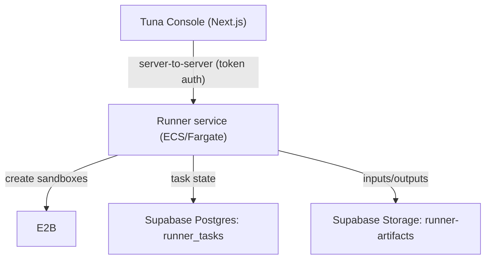

# AWS Deployment (Runner Service)

This guide provides deploy-ready ECS/Fargate assets for `tuna-runner`.

## Topology (high level)

## ECS/Fargate Assets (recommended)

- Task definition template: `e2b-runner-service/deploy/aws/runner-task-definition.template.json`
- Service template: `e2b-runner-service/deploy/aws/runner-service.template.json`
- Shared runbook: `deploy/aws/rollout-rollback-runbook.md`
- Env/secrets matrix: `deploy/aws/env-secrets-mapping.md`
- IAM checklist: `deploy/aws/iam-checklist.md`

## Deployment Flow

1. **Build & push image**
   - Build the Docker image from `e2b-runner-service/Dockerfile`.
   - Push to ECR.

2. **Render templates**
   - Replace `${...}` placeholders in both runner JSON templates.
   - Keep secrets mapped through ECS `secrets` entries (Secrets Manager/SSM), not inline env values.

3. **Register task definition and update service**
   - `aws ecs register-task-definition --cli-input-json file://e2b-runner-service/deploy/aws/runner-task-definition.resolved.json`
   - `aws ecs update-service --cluster <cluster> --service tuna-runner --task-definition <new-arn> --force-new-deployment`

4. **Networking**
   - Fargate launch type.
   - Private subnets + security group (allow inbound only from app service/LB).
   - For interactive sessions, prefer **single task replica** or ALB **sticky sessions**. Session state is process-memory and is not shared across replicas.

5. **Configure auth**
   - Set `E2B_RUNNER_TOKEN` in the app (server-only).
   - The runner validates `Authorization: Bearer <token>`.

## Health check

`GET /` returns a basic service descriptor (no auth required). For authenticated checks, use `GET /config`.

## Notes

- Keep the runner **separate from Vercel** (long-running tasks + background threads).
- Use private networking when possible; otherwise keep `RUNNER_AUTH_TOKEN` enabled.
- If you must scale replicas >1, configure stickiness at the load balancer layer for runner session routes.
